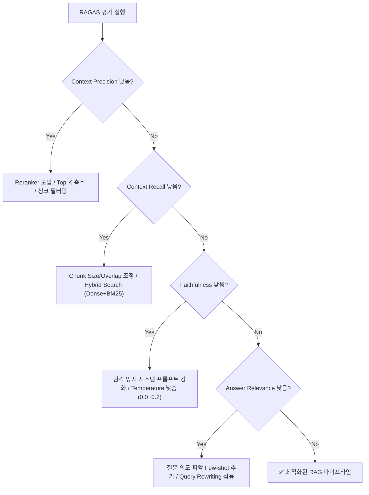

# RAG 시스템 평가의 필요성

RAG(Retrieval-Augmented Generation) 시스템을 구축할 때 가장 흔히 겪는 어려움은 **"이 시스템이 얼마나 잘 동작하고 있는가?"**를 객관적으로 측정하기 어렵다는 점이다.

전통적인 머신러닝이나 자연어 처리(NLP)에서는 BLEU, ROUGE 같은 n-gram 일치 기반 지표를 많이 사용했다. 하지만 이러한 지표는 다음과 같은 한계가 있다.

- 표현이 조금만 바뀌어도 점수가 급격히 하락한다.
- 의미론적 유사성이나 정보의 사실성(Factuality)을 제대로 반영하지 못한다.
- 검색(Retrieval) 단계의 실패인지, 생성(Generation) 단계의 실패인지 원인을 구분할 수 없다.

RAG 시스템이 오답을 출력했을 때 그 원인은 크게 두 가지로 나뉜다.

1. **검색 실패**: 검색기가 질문과 관련된 문서를 찾아오지 못했거나 순위가 너무 낮아 LLM 컨텍스트에 포함되지 않은 경우
2. **생성 실패**: 관련 문맥을 올바르게 제공받았음에도 LLM이 정보를 왜곡하거나 환각(Hallucination)을 일으킨 경우

이러한 문제를 컴포넌트별로 정량 평가하기 위해 고안된 프레임워크가 바로 **RAGAS(Retrieval Augmented Generation Assessment)**이다.

&nbsp;

# RAG Triad와 RAGAS 아키텍처

RAGAS는 RAG 파이프라인의 4가지 핵심 요소인 **Question(질문)**, **Context(검색된 문맥)**, **Answer(생성된 답변)**, **Ground Truth(정답 레이블)** 간의 관계를 바탕으로 지표를 정의한다.


RAGAS는 크게 **검색(Retrieval) 평가**와 **생성(Generation) 평가**로 나누어 4대 핵심 지표를 제공한다.

| 평가 영역 | 핵심 지표 | 평가 대상 관계 | 기준 정답(Ground Truth) 필요 여부 |
| :--- | :--- | :--- | :---: |
| **Retrieval** | **Context Precision** | Question $\leftrightarrow$ Context | ❌ (또는 선택) |
| **Retrieval** | **Context Recall** | Ground Truth $\leftrightarrow$ Context | ⭕ |
| **Generation** | **Faithfulness** | Context $\leftrightarrow$ Answer | ❌ |
| **Generation** | **Answer Relevance** | Question $\leftrightarrow$ Answer | ❌ |

Ground Truth가 없어도 3가지 핵심 지표(Faithfulness, Answer Relevance, Context Precision)를 평가할 수 있다는 점이 RAGAS의 큰 강점 중 하나다.

&nbsp;

# RAGAS 4대 핵심 평가지표 심층 분석

## 1. Context Precision (문맥 정밀도)

### 개념
Context Precision은 검색기(Retriever)가 가져온 상위 k개의 청크(Context) 중, **질문 답변에 실제로 유용한 정보가 상위 순위에 얼마나 잘 배치되었는지**를 평가한다.

단순히 관련 문서가 포함되었는지만 보는 것이 아니라, 관련 문서가 1위나 2위에 있을 때 더 높은 점수를 부여하는 랭킹 품질 지표(Average Precision 기반)이다.

### 수식
$$
\text{Context Precision@k} = \frac{\sum_{k=1}^{K} (\text{Precision@}k \times v_k)}{\text{총 유의미한 청크 수}}
$$

- $v_k \in \{0, 1\}$: $k$번째 청크가 질문 답변에 유용한 정보인지 여부 (LLM이 판별)
- $\text{Precision@}k = \frac{\text{상위 } k \text{개 중 유의미한 청크 수}}{k}$

상위에 관련 없는 노이즈 청크가 많고 유용한 청크가 뒤로 밀려날수록 점수가 낮아진다.

&nbsp;

## 2. Context Recall (문맥 재현율)

### 개념
Context Recall은 **기준 정답(Ground Truth)을 작성하는 데 필요한 모든 핵심 사실(Fact)이 검색된 문맥에 온전히 포함되어 있는지**를 평가한다.

검색기가 필요한 핵심 근거를 누락하면 생성 모델이 아무리 뛰어나도 정답을 만들 수 없으므로, 검색 파이프라인의 누락률을 측정하는 핵심 지표이다.

### 측정 메커니즘
1. LLM을 사용하여 Ground Truth 문장을 개별 주장(Statement/Claim) 단위로 분해한다.
2. 각 주장이 검색된 Context에서 직접 확인(Attributed)될 수 있는지 여부를 LLM으로 검증한다.
3. 확인된 주장 수를 전체 Ground Truth 주장 수로 나눈다.

$$
\text{Context Recall} = \frac{|\text{Context에서 확인된 Ground Truth 주장 수}|}{|\text{Ground Truth의 전체 주장 수}|}
$$

&nbsp;

## 3. Faithfulness (충실도 / 신뢰도)

### 개념
Faithfulness는 생성된 Answer가 **오직 검색된 Context에 기반하고 있는지**를 평가한다. 즉, **환각(Hallucination) 방지 지표**이다.

모델이 외부 지식을 임의로 덧붙이거나 문맥에 없는 사실을 지어내면 Faithfulness 점수가 낮아진다.

### 측정 메커니즘
1. 생성된 Answer를 여러 개의 원자 단위 주장(Statements)으로 분해한다.
2. 각 주장이 주어진 Context로부터 연역적으로 추론 가능한지(Entailment) 검증한다.
3. 지지되는 주장의 비율을 계산한다.

$$
\text{Faithfulness} = \frac{|\text{Context로부터 입증 가능한 주장 수}|}{|\text{생성된 Answer의 전체 주장 수}|}
$$

점수는 0.0에서 1.0 사이이며, 1.0에 가까울수록 환각이 없는 충실한 답변임을 의미한다.

&nbsp;

## 4. Answer Relevance (답변 관련성)

### 개념
Answer Relevance는 생성된 Answer가 **사용자의 원래 Question에 직접적으로 부합하는지**를 평가한다.

답변이 문맥에 충실하더라도, 질문의 의도와 동떨어진 부가 설명만 길게 늘어놓거나 질문의 핵심을 비껴가면 낮은 점수를 받는다.

### 측정 메커니즘
1. 생성된 Answer만을 LLM에게 제공하고, 이 답변을 유도했을 법한 가상 질문 $q_i$를 $n$개 역생성(Reverse Generation)한다.
2. 역생성된 가상 질문들과 원래의 사용자 질문($q$) 간의 임베딩 코사인 유사도(Cosine Similarity)를 계산하여 평균을 낸다.

$$
\text{Answer Relevance} = \frac{1}{n} \sum_{i=1}^{n} \text{CosineSimilarity}(E(q), E(q_i))
$$

- $E(\cdot)$: 텍스트 임베딩 모델

&nbsp;

# RAGAS 실습 (Jupyter Notebook)

아래는 Python 및 RAGAS 라이브러리를 활용하여 4대 평가지표를 직접 계산하는 실습 코드다.

## 1. 패키지 설치 및 환경 설정

```python
!pip install -q ragas datasets langchain-openai pandas
```

```python
import os
import pandas as pd
from datasets import Dataset

# OpenAI API 키 설정 (또는 .env / 환경 변수 사용)
os.environ["OPENAI_API_KEY"] = "your-openai-api-key"
```

&nbsp;

## 2. 평가용 데이터셋(Testset) 준비

RAGAS 평가를 위해서는 다음 4가지 필드로 구성된 데이터가 필요하다.

- `question`: 사용자 질문
- `contexts`: 검색기(Retriever)가 가져온 텍스트 청크 리스트 (`list[str]`)
- `answer`: LLM이 생성한 최종 답변
- `ground_truth`: 기준 정답 텍스트

```python
data = {
    "question": [
        "RAG 시스템에서 Vector DB의 주된 역할은 무엇인가?",
        "Chirpy 테마에서 블로그 포스트 파일명 규칙은 어떻게 되는가?"
    ],
    "contexts": [
        [
            "Vector Database는 Embedding된 벡터를 저장하고, 질문 벡터와 가까운 문서 벡터를 유사도(Cosine Similarity 등) 기반으로 빠르게 찾는 저장소다.",
            "RAG 파이프라인에서 문서 파싱 후 청킹과 임베딩 과정을 거쳐 벡터 DB에 인덱싱된다."
        ],
        [
            "Jekyll Chirpy 테마의 게시물 파일은 _posts 디렉터리에 위치해야 한다.",
            "파일명은 YYYY-MM-DD-제목.md 형식을 따라야 하며, 날짜가 누락되면 빌드 시 글이 무시된다."
        ]
    ],
    "answer": [
        "Vector DB는 임베딩된 문서 벡터를 저장하고 질문과 의미적으로 유사한 문서를 고속으로 검색하는 역할을 합니다.",
        "포스트 파일명은 _posts 폴더 아래에 YYYY-MM-DD-제목.md 형식으로 작성해야 합니다."
    ],
    "ground_truth": [
        "임베딩 벡터를 저장하고 유사도 검색(Cosine, Dot Product 등)을 통해 질문과 관련된 문서 청크를 빠르게 검색하는 것.",
        "_posts 폴더 내에 YYYY-MM-DD-제목.md 형식으로 작성한다."
    ]
}

dataset = Dataset.from_dict(data)
dataset
```

    Dataset({
        features: ['question', 'contexts', 'answer', 'ground_truth'],
        num_rows: 2
    })

&nbsp;

## 3. RAGAS 메트릭 로드 및 평가 실행

```python
from ragas import evaluate
from ragas.metrics import (
    context_precision,
    context_recall,
    faithfulness,
    answer_relevance
)

# 평가할 지표 목록 정의
metrics = [
    context_precision,
    context_recall,
    faithfulness,
    answer_relevance
]

# 평가 실행
result = evaluate(
    dataset=dataset,
    metrics=metrics
)

print(result)
```

    evaluating with [context_precision, context_recall, faithfulness, answer_relevance]
    100%|██████████| 8/8 [00:04<00:00,  1.78it/s]
    {'context_precision': 1.0000, 'context_recall': 1.0000, 'faithfulness': 1.0000, 'answer_relevance': 0.9654}

&nbsp;

## 4. 결과 분석 및 DataFrame 변환

```python
# 결과를 Pandas DataFrame으로 변환하여 세부 항목 확인
df_result = result.to_pandas()
df_result[["question", "context_precision", "context_recall", "faithfulness", "answer_relevance"]]
```

| | question | context_precision | context_recall | faithfulness | answer_relevance |
| :--- | :--- | :---: | :---: | :---: | :---: |
| **0** | RAG 시스템에서 Vector DB의 주된 역할은 무엇인가? | 1.0000 | 1.0000 | 1.0000 | 0.9582 |
| **1** | Chirpy 테마에서 블로그 포스트 파일명 규칙은 어떻게 되는가? | 1.0000 | 1.0000 | 1.0000 | 0.9726 |


&nbsp;

# 점수 기반 파이프라인 튜닝 전략

RAGAS 평가 점수에 따라 어떤 컴포넌트를 개선해야 하는지 명확한 우선순위를 잡을 수 있다.



### 1. Context Recall이 낮을 때 (검색 누락)
- **원인**: 필요한 문서 청크가 검색 결과 자체에 포함되지 않음.
- **해결책**:
  - Dense Search 단독 사용 대신 **BM25를 결합한 Hybrid Search** 도입
  - Chunk Size를 늘리거나 Chunk Overlap 비율 확대
  - 도메인 특화 임베딩 파인튜닝 또는 쿼리 확장(Query Expansion) 기법 적용

### 2. Context Precision이 낮을 때 (검색 랭킹 불량)
- **원인**: 관련 청크가 검색되기는 했으나 하위 순위에 머물러 있음.
- **해결책**:
  - 초기 검색 후 Cross-Encoder 기반의 **Reranker(예: bge-reranker, Cohere Rerank)** 적용
  - 불필요한 노이즈 문서를 걸러내기 위한 유사도 임계값(Threshold) 설정

### 3. Faithfulness가 낮을 때 (환각 발생)
- **원인**: LLM이 주어진 문맥에 없는 내용을 지어내거나 추론 왜곡.
- **해결책**:
  - 프롬프트에 *"주어진 Context에 명시된 사실에만 근거하여 답변하고, 정보가 없으면 '확인되지 않습니다'라고 답할 것"*과 같은 가드레일 추가
  - LLM의 `temperature`를 0.0 또는 0.2 이하로 하향 조정

### 4. Answer Relevance가 낮을 때 (질문 의도 불일치)
- **원인**: 질문의 요점을 파악하지 못하고 엉뚱하거나 장황한 답변 출력.
- **해결책**:
  - 사용자 질문을 더 명확하게 가공하는 **Query Rewriting / HyDE(Hypothetical Document Embeddings)** 적용
  - 의도 분석 프롬프트 및 Few-shot 예시 추가

&nbsp;

# 마무리

RAG 시스템의 고도화는 직관이나 몇 가지 샘플 질문에 의존해서는 한계가 있다. 
RAGAS를 활용해 **Retrieval(Context Precision, Context Recall)**과 **Generation(Faithfulness, Answer Relevance)**의 지표를 정량적으로 추적하면서 데이터 중심의 최적화 사이클을 구축하는 것이 프로덕션 레벨 RAG의 핵심이다.

&nbsp;
- 참고자료
    - [https://medium.com/@danushidk507/evaluation-with-ragas-873a574b86a9](https://medium.com/@danushidk507/evaluation-with-ragas-873a574b86a9)