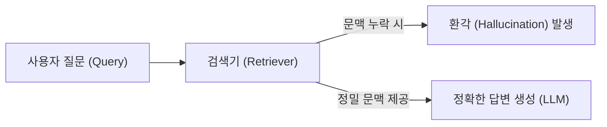
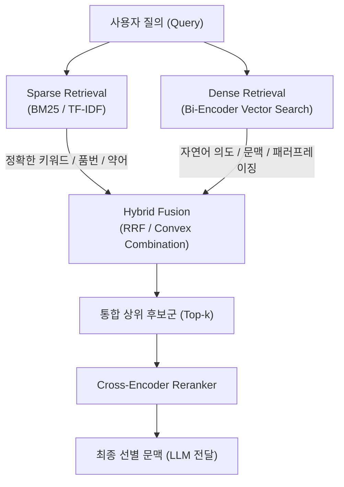
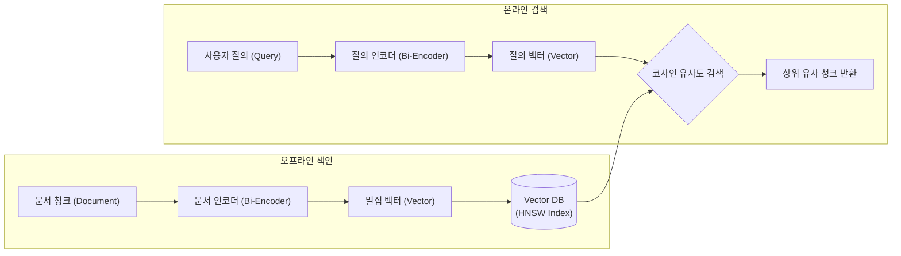
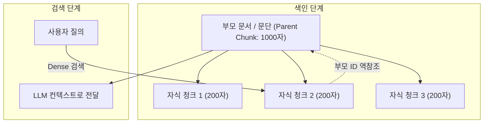
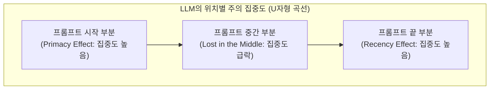
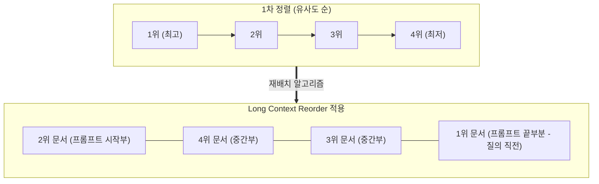

# RAG에서 검색(Retrieval)이 중요한 이유

RAG(Retrieval-Augmented Generation) 시스템의 성공 여부는 생성(Generation) 모델인 LLM보다 **검색(Retrieval) 시스템의 품질**에 의해 결정되는 경우가 많다.

아무리 뛰어난 초거대 언어 모델이라도 프롬프트로 주어지는 문맥(Context)에 정답 근거가 빠져 있거나 잘못된 정보가 섞여 있다면, 올바른 답변을 생성하지 못하거나 환각(Hallucination)을 일으킨다. 이를 정보 검색 분야에서는 **"Garbage In, Garbage Out"**이라고 부른다.



많은 프로덕션 환경에서 RAG를 도입할 때 초기에는 단순히 문서를 청킹(Chunking)하고 벡터 데이터베이스(Vector DB)에 넣어 유사도 검색(Dense Search)을 수행하는 형태로 시작한다. 하지만 이 단순한 방식(Naive RAG)은 실무에서 다음과 같은 한계에 부딪힌다.

1. **정확한 키워드 매칭 실패**: 모델 번호, 에러 코드, 고유명사, 약어 등은 벡터 임베딩 공간에서 엉뚱한 문서와 가깝게 묶일 수 있다.
2. **문맥 소실(Context Fragmentation)**: 작은 청크 단위로 나누면 검색 정확도는 올라가지만 원래 문서가 가진 전체적인 의미 맥락이 손실된다.
3. **순위 왜곡(Ranking Distortion)**: 임베딩 유사도가 높다고 해서 그 문서가 실제 질문에 가장 정확한 답변 근거라는 보장은 없다.

이 글에서는 RAG 검색의 기본 축인 **Sparse, Dense, Hybrid Search**부터, 검색 품질을 비약적으로 끌어올리는 **고급 검색 기법(HyDE, 계층적 검색, Reranking)**까지 체계적으로 정리하고 실전 구현 코드를 살펴본다.

&nbsp;

# RAG 검색 기법의 3대 핵심 축



---

## 1. Sparse Retrieval (키워드/어휘 기반 검색)

Sparse Retrieval은 텍스트 내에 단어가 실제로 등장하는 빈도와 문서군 전체에서의 희귀도를 기반으로 희소 벡터(Sparse Vector)를 구성해 일치도를 계산하는 전통적인 정보 검색(Information Retrieval) 방식이다.

### 대표 알고리즘: BM25 (Best Matching 25)
TF-IDF의 단점(문서 길이가 길어질수록 점수가 과도하게 높아지는 문제 등)을 개선한 확률적 랭킹 알고리즘이다.

$$
\text{Score}(D, Q) = \sum_{i=1}^{n} \text{IDF}(q_i) \cdot \frac{f(q_i, D) \cdot (k_1 + 1)}{f(q_i, D) + k_1 \cdot \left(1 - b + b \cdot \frac{|D|}{\text{avgdl}}\right)}
$$

* $f(q_i, D)$: 단어 $q_i$가 문서 $D$ 내에 등장하는 빈도 (Term Frequency)
* $\lvert D \rvert$ 및 $\text{avgdl}$: 대상 문서 길이 및 전체 문서들의 평균 길이
* $k_1, b$: 하이퍼파라미터 (일반적으로 $k_1 \in [1.2, 2.0]$, $b \approx 0.75$)

### 장점
* **고유명사 및 코드 매칭**: 제품 코드, 규격 번호, 함수명, 시스템 에러 로그(`ERR-404-01`), 약어 등 정확한 토큰 일치가 필요한 경우 압도적인 성능을 낸다.
* **낮은 연산 비용**: 별도의 신경망 추론이나 GPU가 필요하지 않아 인덱싱과 검색 속도가 매우 빠르다.

### 한계
* **어휘 불일치(Vocabulary Mismatch)**: 사용자가 "노트북"으로 질문했을 때 문서에 "랩톱" 또는 "휴대용 PC"라고만 적혀 있다면 관련성을 감지하지 못한다.
* **문맥 및 의도 이해 불가**: 문장의 의미 구조나 다의어(예: 금융의 '은행' vs 나무의 '은행')를 구별하기 어렵다.

&nbsp;

## 2. Dense Retrieval (의미 기반 밀집 검색)

Dense Retrieval은 사전 학습된 임베딩 모델(Bi-Encoder)을 사용하여 텍스트의 의미적 문맥을 고차원 실수 벡터(Dense Vector, 보통 768~3072차원)로 변환한 뒤 벡터 간 유사도를 계산한다.



### 유사도 척도
주로 두 벡터의 방향 유사도를 측정하는 **코사인 유사도(Cosine Similarity)**를 사용한다.

$$
\text{Cosine Similarity}(\vec{u}, \vec{v}) = \frac{\vec{u} \cdot \vec{v}}{\|\vec{u}\| \|\vec{v}\|}
$$

### 장점
* **의미론적 유사도 파악**: 단어가 완전히 일치하지 않더라도 문맥과 질문 의도가 비슷하면 문서를 정확하게 찾아낸다.
* **다국어 및 패러프레이징 대응**: 표현의 변형이나 교차 언어(Cross-lingual) 질의에도 강건하게 동작한다.

### 한계
* **세부 토큰 누락**: 숫자의 사소한 차이, negation(부정어: '안 된다' vs '된다'), 특정 식별자 매칭에서 취약점을 보인다.
* **도메인 특화 약점 (Out-of-Domain)**: 일반 텍스트로 학습된 공개 임베딩 모델은 사내 전문 용어나 특수 도메인 용어를 제대로 임베딩하지 못할 수 있다.

&nbsp;

## 3. Hybrid Retrieval (하이브리드 검색)

실무 RAG 환경에서는 Sparse와 Dense 둘 중 하나만 선택하는 대신, **두 검색 결과를 결합하는 Hybrid Search**가 사실상의 표준(De facto standard)이다.

### 결합 방식: RRF (Reciprocal Rank Fusion)
두 검색기의 점수 산출 방식(BM25 점수 vs 코사인 유사도)이 서로 다르기 때문에, 점수 자체를 직접 더하기보다는 각 검색기가 매긴 **순위(Rank)**만을 활용하여 공정하게 결합하는 RRF가 가장 널리 쓰인다.

$$
\text{RRF\_Score}(d) = \sum_{m \in M} \frac{1}{k + r_m(d)}
$$

* $M$: 사용하는 검색기 집합 (예: $\{\text{BM25}, \text{Dense}\}$)
* $r_m(d)$: 검색기 $m$에서 문서 $d$가 차지한 순위 (1-indexed)
* $k$: 랭킹 상수 (일반적으로 $k = 60$)

상위권에 랭크된 문서일수록 높은 가중치를 받으며, 특정 검색기의 극단적인 스코어 왜곡에 흔들리지 않는 장점이 있다.

&nbsp;

# 검색 정밀도를 높이는 고급 검색 기법 (Advanced Retrieval)

단순 하이브리드 검색을 넘어, 프로덕션 환경의 복잡한 요구사항을 해결하기 위해 고안된 대표적인 고급 기법 3가지를 살펴본다.

## 1. Query Transformation (질의 변환)

사용자의 원본 질의는 길이가 너무 짧거나 모호하거나 키워드가 누락되어 있는 경우가 많다. 이를 검색에 적합한 형태로 변환한다.

* **HyDE (Hypothetical Document Embeddings)**:
  질문에 대해 LLM이 먼저 "가상의 답변(Hypothetical Answer)"을 1~2문장 생성한다. 이 가상 답변은 질문보다 실제 기술 문서와 스타일 및 어휘 분포가 유사하므로, 이를 임베딩하여 검색하면 검색 성공률이 크게 높아진다.
* **Multi-Query Expansion**:
  하나의 질문을 3~4개의 다른 관점이나 유의어를 포함한 질문으로 확장하여 병렬 검색한 후 합집합을 취한다.
* **Sub-query Decomposition**:
  복합 질의(예: "A사와 B사의 작년 매출액과 주요 사업부 차이점 비교")를 독립적인 하위 질의로 쪼개어 각각 검색한다.

&nbsp;

## 2. 계층적 검색 (Parent Document / Small-to-Big Retrieval)

RAG 청킹의 딜레마는 **"검색을 위해서는 청크가 작을수록 좋고, LLM이 이해하기 위해서는 청크가 클수록 좋다"**는 점이다.

* 청크가 너무 크면: 여러 주제가 섞여 임베딩의 의미가 흐려지고 검색 정확도가 떨어진다.
* 청크가 너무 작으면: 문맥이 잘려 LLM이 답변 근거로 활용하기에 정보가 부족하다.



Parent Document Retriever는 문서를 작은 단위(예: 문장/200자)로 쪼개어 인덱싱하되, 검색 시 매칭된 자식 청크의 원본 부모 문단(예: 1000자)을 찾아 LLM에 전달하는 방식으로 이 딜레마를 해결한다.

&nbsp;

## 3. Reranking (Cross-Encoder 재순위화)

1차 검색기(Bi-Encoder 및 BM25)는 속도가 빠르지만, 질의와 문서를 독립적으로 다루기 때문에 둘 사이의 미묘한 상호작용(Token Interaction)을 완벽히 포착하지 못한다.

**Cross-Encoder Reranker**는 질의와 문서를 하나의 입력(`[CLS] Query [SEP] Document [EOS]`)으로 묶어 어텐션(Attention)을 계산하므로 검색 적합도를 훨씬 정밀하게 채점한다.

| 구분 | Bi-Encoder (1차 검색) | Cross-Encoder (Reranker) |
| :--- | :--- | :--- |
| **입력 방식** | Query와 Doc을 각각 따로 임베딩 | Query와 Doc을 결합하여 동시 입력 |
| **토큰 상호작용** | ❌ (벡터 내적만 계산) | ⭕ (모든 토큰 간 Full Attention) |
| **속도** | 수백만 건 밀리초(ms) 단위 검색 | 상대적으로 느림 (연산량 큼) |
| **역할** | Top-50~100 후보 문서 신속 추출 | Top-50에서 최상위 3~5개 정밀 선별 |

&nbsp;

# 컨텍스트 후처리와 "Lost in the Middle" 문제

검색기와 리랭커가 아무리 질문에 적합한 문서들을 잘 찾아냈더라도, 이를 **LLM의 프롬프트 컨텍스트에 어떤 순서와 형태로 배치하는가**에 따라 최종 생성 품질이 크게 달라진다.

## 1. Lost in the Middle 현상이란?

스탠퍼드 대학교의 Liu et al.(2023)이 발표한 논문 *"Lost in the Middle: How Language Models Use Long Contexts"*에 따르면, 트랜스포머 기반 대형 언어 모델(LLM)은 긴 컨텍스트 윈도우 내에서 **정보의 물리적 위치에 따라 회상 및 활용 능력의 심각한 편차**를 보인다.



* **Primacy Effect (초두 효과)**: 프롬프트의 맨 앞(시작부)에 위치한 문맥에 높은 어텐션을 부여한다.
* **Recency Effect (최신 효과)**: 질문 직전인 프롬프트의 맨 뒤(끝부분)에 위치한 문맥에도 높은 어텐션을 부여한다.
* **Middle Valley (중간 계곡 현상)**: 반면 프롬프트의 중간에 끼어 있는 문서들은 모델의 주의가 급격히 분산되면서 **존재하지 않는 정보처럼 무시(Lost)**되거나 답변 생성에 제대로 반영되지 못한다.

RAG 시스템에서 검색기나 리랭커가 가져온 상위 10~20개의 청크를 단순히 유사도 순서(`문서 1 -> 문서 2 -> ... -> 문서 20`)로 프롬프트에 주입하면, 중간 순위(5~15위)에 배치된 결정적 근거 문맥을 모델이 간과하여 환각을 유발하게 된다.

&nbsp;

## 2. 해결 전략

### (1) Long Context Reorder (문맥 재배치)
가장 관련성이 높은 핵심 문서가 '중간 계곡'에 빠지지 않도록, 랭킹 점수가 높은 문서들을 **프롬프트의 시작과 끝 양극단에 번갈아 배치**하는 전략이다.



최상위 문서(1위, 2위)를 LLM이 가장 집중해서 읽는 양 끝단에 배치하고, 상대적으로 덜 중요한 문서를 중앙에 배치함으로써 정보 유실을 방어한다.

### (2) 엄격한 Top-k 압축 (Aggressive Reranking & Filtering)
"LLM의 컨텍스트 윈도우가 128k/1M 토큰으로 늘어났으니 20~30개를 다 넣어도 된다"는 생각은 위험하다. 컨텍스트가 길어질수록 노이즈 토큰이 증가하고 중간 계곡의 폭이 넓어진다.
Cross-Encoder Reranker를 통해 관련도 점수가 명확한 **최상위 3~5개 청크만 엄선**하여 LLM에 전달하는 것이 훨씬 안전하다.

### (3) Contextual Compression (핵심 문장 추출)
청크 전체(예: 1000자)를 통째로 넣는 대신, 질문과 직접 관련된 핵심 2~3문장만 선택적으로 추출(Extraction)하여 주입함으로써 불필요한 문맥 노이즈를 제거한다.

### (4) 구조화된 프롬프트와 인용(Citation) 강제
문서마다 `[문서 1]`, `[문서 2]`와 같이 명시적인 식별자를 부여하고, LLM에게 *"제공된 모든 문서를 순차적으로 검토하고, 답변 시 반드시 근거가 된 문서 번호를 인용하라"*고 시스템 프롬프트에서 강제함으로써 모델이 중간 문서들을 건너뛰지 못하게 유도한다.

&nbsp;

# 실전 실습: Hybrid Search + Reranker + 문맥 재배치 파이프라인 구현

아래는 Python을 사용하여 **BM25(Sparse)**와 **Dense Vector**를 결합하고, **RRF**, **Cross-Encoder Reranker**, 그리고 **Long Context Reorder**까지 적용하는 완성형 RAG 검색 파이프라인 코드다.

## 1. 패키지 설치

```bash
pip install rank-bm25 sentence-transformers numpy
```

## 2. 전체 구현 코드

```python
import numpy as np
from rank_bm25 import BM25Okapi
from sentence_transformers import SentenceTransformer, CrossEncoder

# ---------------------------------------------------------
# 1. 문서 코퍼스(Corpus) 정의
# ---------------------------------------------------------
corpus = [
    "Kafka는 실시간 데이터 스트리밍 파이프라인과 대용량 이벤트 처리를 위한 분산 메시징 플랫폼이다.",
    "Airflow는 데이터 파이프라인의 스케줄링 및 모니터링을 코드로 관리하는 워크플로우 오케스트레이션 도구이다.",
    "RAG(Retrieval-Augmented Generation)는 외부 지식을 검색하여 LLM의 생성 능력을 보강하고 환각을 줄이는 기술이다.",
    "BM25는 단어 빈도와 문서 길이를 정규화하여 관련도를 평가하는 대표적인 Sparse 검색 알고리즘이다.",
    "Dense Retrieval은 문맥과 의미를 다차원 밀집 벡터로 변환하여 코사인 유사도로 유사 문서를 검색한다.",
    "Hybrid Search는 BM25의 키워드 매칭과 Dense Search의 의미 기반 검색을 결합하여 검색 품질을 안정화한다.",
    "Cross-Encoder Reranker는 질문과 문서를 동시에 입력받아 둘 사이의 상호작용을 정밀하게 재순위화한다."
]

# ---------------------------------------------------------
# 2. 모델 로드 (Dense Embedder & Cross-Encoder Reranker)
# ---------------------------------------------------------
# 한국어/영어 범용 임베딩 모델
dense_model = SentenceTransformer("snunlp/KR-SBERT-V404-snunlp-bpe")
# 문맥 적합도 판별을 위한 경량 Cross-Encoder
reranker_model = CrossEncoder("BAAI/bge-reranker-base")

# ---------------------------------------------------------
# 3. 색인(Indexing) 구축
# ---------------------------------------------------------
# (1) BM25 인덱스 (토큰화)
tokenized_corpus = [doc.split(" ") for doc in corpus]
bm25 = BM25Okapi(tokenized_corpus)

# (2) Dense 임베딩 인덱스
corpus_embeddings = dense_model.encode(corpus, normalize_embeddings=True)

# ---------------------------------------------------------
# 4. 검색 함수 정의 (Sparse, Dense, RRF Hybrid)
# ---------------------------------------------------------
def search_sparse(query: str, top_k: int = 5):
    """BM25 기반 키워드 검색"""
    tokenized_query = query.split(" ")
    scores = bm25.get_scores(tokenized_query)
    ranked_indices = np.argsort(scores)[::-1][:top_k]
    return [(idx, float(scores[idx])) for idx in ranked_indices]

def search_dense(query: str, top_k: int = 5):
    """코사인 유사도 기반 Dense 검색"""
    query_embedding = dense_model.encode(query, normalize_embeddings=True)
    similarities = np.dot(corpus_embeddings, query_embedding)
    ranked_indices = np.argsort(similarities)[::-1][:top_k]
    return [(idx, float(similarities[idx])) for idx in ranked_indices]

def reciprocal_rank_fusion(sparse_results, dense_results, k: int = 60):
    """RRF (Reciprocal Rank Fusion) 알고리즘으로 두 랭킹 결합"""
    rrf_scores = {}
    
    # Sparse 순위 반영
    for rank, (doc_idx, _) in enumerate(sparse_results, start=1):
        rrf_scores[doc_idx] = rrf_scores.get(doc_idx, 0.0) + (1.0 / (k + rank))
        
    # Dense 순위 반영
    for rank, (doc_idx, _) in enumerate(dense_results, start=1):
        rrf_scores[doc_idx] = rrf_scores.get(doc_idx, 0.0) + (1.0 / (k + rank))
        
    # 점수 기준 내림차순 정렬
    sorted_docs = sorted(rrf_scores.items(), key=lambda x: x[1], reverse=True)
    return sorted_docs

def rerank(query: str, candidate_indices, top_n: int = 4):
    """Cross-Encoder를 사용한 최종 재순위화"""
    pairs = [[query, corpus[idx]] for idx in candidate_indices]
    rerank_scores = reranker_model.predict(pairs)
    
    scored_candidates = list(zip(candidate_indices, rerank_scores))
    scored_candidates.sort(key=lambda x: x[1], reverse=True)
    return scored_candidates[:top_n]

def reorder_documents(ranked_docs):
    """
    Lost in the Middle 방지를 위한 LongContextReorder 구현:
    최상위(중요) 문서들을 프롬프트의 양 끝단(시작과 끝)에 배치하고,
    하위 문서를 중앙에 배치한다.
    """
    docs = list(reversed(ranked_docs))
    reordered = []
    for i, doc in enumerate(docs):
        if i % 2 == 1:
            reordered.append(doc)
        else:
            reordered.insert(0, doc)
    return reordered

# ---------------------------------------------------------
# 5. 실행 및 결과 검증
# ---------------------------------------------------------
query = "단어 일치 검색과 의미 벡터 검색을 함께 쓰는 방법"
print(f"질의어: '{query}'\n")

# 1) Sparse & Dense 검색 각각 수행 (Top 4)
sparse_hits = search_sparse(query, top_k=4)
dense_hits = search_dense(query, top_k=4)

# 2) RRF 하이브리드 결합
hybrid_hits = reciprocal_rank_fusion(sparse_hits, dense_hits, k=60)
candidate_ids = [doc_idx for doc_idx, _ in hybrid_hits[:4]]

print("=== [1단계] Hybrid Search (RRF) 후보군 ===")
for rank, (idx, score) in enumerate(hybrid_hits[:4], start=1):
    print(f"[{rank}위] RRF점수: {score:.5f} | {corpus[idx]}")

# 3) Reranking 수행 (상위 4개 선정)
reranked_hits = rerank(query, candidate_ids, top_n=4)

print("\n=== [2단계] Cross-Encoder Reranking 결과 ===")
for rank, (idx, score) in enumerate(reranked_hits, start=1):
    print(f"[{rank}위] Reranker점수: {score:.4f} | {corpus[idx]}")

# 4) Lost in the Middle 방지를 위한 문맥 재배치 (Long Context Reorder)
final_reordered_docs = reorder_documents(reranked_hits)

print("\n=== [3단계] Long Context Reorder 최종 프롬프트 주입 순서 ===")
for pos, (idx, score) in enumerate(final_reordered_docs, start=1):
    pos_desc = "맨 앞 (Beginning)" if pos == 1 else ("맨 뒤 (End - 질의 직전)" if pos == len(final_reordered_docs) else "중간부 (Middle)")
    print(f"[위치 {pos} - {pos_desc}] 점수: {score:.4f} | {corpus[idx]}")
```

### 코드 실행 결과 예시
```text
질의어: '단어 일치 검색과 의미 벡터 검색을 함께 쓰는 방법'

=== [1단계] Hybrid Search (RRF) 후보군 ===
[1위] RRF점수: 0.03252 | Hybrid Search는 BM25의 키워드 매칭과 Dense Search의 의미 기반 검색을 결합하여 검색 품질을 안정화한다.
[2위] RRF점수: 0.01639 | Dense Retrieval은 문맥과 의미를 다차원 밀집 벡터로 변환하여 코사인 유사도로 유사 문서를 검색한다.
[3위] RRF점수: 0.01613 | BM25는 단어 빈도와 문서 길이를 정규화하여 관련도를 평가하는 대표적인 Sparse 검색 알고리즘이다.
[4위] RRF점수: 0.01587 | RAG(Retrieval-Augmented Generation)는 외부 지식을 검색하여 LLM의 생성 능력을 보강하고 환각을 줄이는 기술이다.

=== [2단계] Cross-Encoder Reranking 결과 ===
[1위] Reranker점수: 4.8210 | Hybrid Search는 BM25의 키워드 매칭과 Dense Search의 의미 기반 검색을 결합하여 검색 품질을 안정화한다.
[2위] Reranker점수: 1.1502 | Dense Retrieval은 문맥과 의미를 다차원 밀집 벡터로 변환하여 코사인 유사도로 유사 문서를 검색한다.
[3위] Reranker점수: -0.4215 | BM25는 단어 빈도와 문서 길이를 정규화하여 관련도를 평가하는 대표적인 Sparse 검색 알고리즘이다.
[4위] Reranker점수: -2.3108 | RAG(Retrieval-Augmented Generation)는 외부 지식을 검색하여 LLM의 생성 능력을 보강하고 환각을 줄이는 기술이다.

=== [3단계] Long Context Reorder 최종 프롬프트 주입 순서 ===
[위치 1 - 맨 앞 (Beginning)] 점수: 1.1502 | Dense Retrieval은 문맥과 의미를 다차원 밀집 벡터로 변환하여 코사인 유사도로 유사 문서를 검색한다.
[위치 2 - 중간부 (Middle)] 점수: -2.3108 | RAG(Retrieval-Augmented Generation)는 외부 지식을 검색하여 LLM의 생성 능력을 보강하고 환각을 줄이는 기술이다.
[위치 3 - 중간부 (Middle)] 점수: -0.4215 | BM25는 단어 빈도와 문서 길이를 정규화하여 관련도를 평가하는 대표적인 Sparse 검색 알고리즘이다.
[위치 4 - 맨 뒤 (End - 질의 직전)] 점수: 4.8210 | Hybrid Search는 BM25의 키워드 매칭과 Dense Search의 의미 기반 검색을 결합하여 검색 품질을 안정화한다.
```

1단계 하이브리드 검색을 통해 키워드 매칭과 벡터 유사도가 모두 높은 후보군들을 포섭하고, 2단계 Cross-Encoder Reranker로 정밀 점수를 매긴 뒤, 3단계 Long Context Reorder를 거쳐 **가장 핵심적인 문서(1위, 2위)가 프롬프트의 양 극단(맨 앞과 맨 뒤)에 배치**됨으로써 'Lost in the Middle' 현상을 효과적으로 방어하게 된다.

&nbsp;

# RAG 검색 기법 선택 가이드

상황과 도메인 특성에 따라 권장되는 검색 기법 조합은 다음과 같다.

| 도메인 / 상황 | 권장 검색 아키텍처 | 주요 이유 |
| :--- | :--- | :--- |
| **사내 기술 문서 / 법률 / 규정** | **Hybrid (BM25 + Dense) + Reranker** | 조항 번호, 규격 코드 등 고유명사와 자연어 질문이 공존하므로 필수적임 |
| **고객 지원(CS) FAQ** | **Dense + HyDE + Reranker** | 질문 문장이 짧고 구어체가 많아 가상 답변 생성(HyDE) 효과가 극대화됨 |
| **긴 매뉴얼 / 보고서 (PDF)** | **Parent Document Retriever** | 표나 세부 문장은 작은 단위로 검색하고 전체 문맥 문단을 LLM에 전달해야 함 |
| **복합 연구 / 멀티홉 질의** | **Sub-query + GraphRAG** | 엔티티 간 연결 관계를 파악하고 여러 소스를 교차 검증해야 함 |

&nbsp;

# 정리

RAG 파이프라인의 고도화는 더 큰 LLM을 채택하는 것보다 **검색 엔진을 정교하게 튜닝하는 것**에서 시작된다.

1. **단일 Dense 검색의 한계를 인정하라**: 고유명사, 품번, 에러 코드가 중요한 실무 데이터에서는 BM25를 결합한 Hybrid Search가 기본값이어야 한다.
2. **Reranker를 적극 도입하라**: 1차 검색에서 넓게 긁어모으고(High Recall), Cross-Encoder로 좁혀내는(High Precision) 투-스테이지(Two-stage) 파이프라인은 품질 개선 효과가 가장 확실한 투자다.
3. **청킹과 검색 단위를 분리하라**: Parent Document Retriever 기법처럼 인덱싱 단위와 LLM 컨텍스트 주입 단위를 분리함으로써 정보의 정밀도와 문맥 완성도를 동시에 확보해야 한다.
4. **"Lost in the Middle"을 방어하라**: 문서가 많아질수록 프롬프트 중간의 정보는 소실되기 쉽다. Reranker로 Top-k를 3~5개 수준으로 압축하고, Long Context Reorder를 적용하여 핵심 근거를 프롬프트의 시작과 끝에 전략적으로 배치해야 한다.
