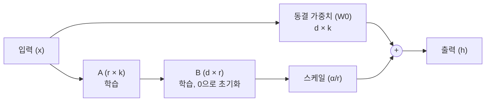
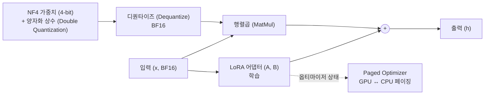
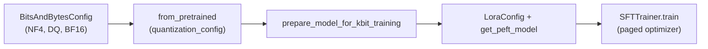

# LLM 파인튜닝에서 메모리가 문제인 이유

LLM을 풀 파인튜닝(Full Fine-tuning)하려면 모델 가중치뿐 아니라 그래디언트와 옵티마이저 상태까지 모두 GPU 메모리에 올려야 한다. QLoRA 논문은 65B 모델을 16-bit로 풀 파인튜닝하려면 780GB 이상의 GPU 메모리가 필요하다고 적었다. 개인이나 작은 팀이 감당하기 어려운 크기다.

LoRA(Low-Rank Adaptation)는 원래 가중치를 얼려 두고 작은 어댑터만 학습해서 학습 파라미터 수를 줄인다. QLoRA는 여기서 한 걸음 더 나아가 **base 모델 자체를 4-bit로 양자화해 얼려 두고, 그 위에서 LoRA 어댑터만 학습한다.** 논문은 이 방법으로 65B 모델을 48GB GPU 한 장에서 파인튜닝했다.


&nbsp;

# LoRA: 가중치 변화를 저랭크로 근사한다

## 개념

LoRA는 사전학습 가중치 $W_0$를 동결하고, 파인튜닝으로 생기는 변화량 $\Delta W$만 두 개의 작은 행렬 곱 $BA$로 학습한다. 큰 행렬 하나를 통째로 업데이트하는 대신 랭크(rank)가 낮은 두 행렬만 학습하므로 학습 파라미터 수가 크게 줄어든다.

LoRA 논문은 GPT-3 175B 기준으로 학습 파라미터를 10,000배, GPU 메모리를 3배 줄였다고 보고했다. 이 수치는 GPT-3 175B 실험 기준이며 다른 모델에 그대로 옮길 수 있는 값은 아니다.

## 수식

선형층의 순전파는 다음과 같다.

$$
h = W_0 x + \Delta W x = W_0 x + \frac{\alpha}{r} B A x
$$

$$
W_0 \in \mathbb{R}^{d \times k}, \quad B \in \mathbb{R}^{d \times r}, \quad A \in \mathbb{R}^{r \times k}, \quad r \ll \min(d, k)
$$

- $A$는 랜덤 가우시안으로, $B$는 0으로 초기화한다. 그래서 학습 시작 시점에는 $\Delta W = BA = 0$이고, 모델은 원래 모델과 같은 출력을 낸다.
- $\Delta W x$에는 $\frac{\alpha}{r}$ 스케일을 곱한다. 논문은 $\alpha$를 튜닝하는 것이 대략 학습률을 튜닝하는 것과 비슷하다고 설명한다.

학습 파라미터 수는 원래 $dk$개에서 $r(d + k)$개로 줄어든다. 가상의 정사각 선형층 $d = k = 4096$에 $r = 16$을 대입하면 다음과 같다.

$$
dk = 4096 \times 4096 = 16{,}777{,}216, \qquad r(d + k) = 16 \times (4096 + 4096) = 131{,}072
$$

이 층 하나에서 학습 파라미터가 128분의 1이 된다. 특정 모델의 실제 층 크기가 아니라 설명용 예시다.

## 동작 방식



학습이 끝나면 $W = W_0 + \frac{\alpha}{r}BA$로 어댑터를 원래 가중치에 병합(merge)할 수 있다. 병합하면 구조상 풀 파인튜닝한 모델과 추론 지연이 같다. 대신 병합한 뒤에는 서로 다른 어댑터를 쓰는 여러 태스크를 한 배치로 처리하기 어렵다고 논문은 적었다.

LoRA를 어느 층에 붙일지도 중요하다. LoRA 논문은 대부분의 실험에서 attention의 $W_q$, $W_v$에만 LoRA를 적용했다. 반면 QLoRA 논문은 **풀 파인튜닝 성능에 맞추려면 트랜스포머 블록의 모든 선형층에 LoRA를 적용해야 한다**고 보고했다. 이 차이는 뒤의 `target_modules` 설정으로 이어진다.

&nbsp;

# QLoRA: 4-bit로 얼린 모델 위에서 LoRA 학습하기

QLoRA는 4-bit로 양자화해 동결한 base 모델을 통해 역전파하면서 LoRA 어댑터만 학습한다. 가중치는 4-bit NF4로 저장하고, 연산할 때는 계산 dtype(보통 BF16)으로 디퀀타이즈(dequantize)해서 쓴다. 4-bit 가중치 자체는 학습하지 않는다. Transformers 문서도 8-bit와 4-bit 학습은 어댑터 같은 추가 파라미터를 학습할 때만 지원한다고 적었다.



## 1. 4-bit NormalFloat(NF4)

NF4는 QLoRA 논문이 제안한 4-bit 데이터 타입이다. 논문 abstract는 NF4를 정규분포를 따르는 가중치에 대해 정보이론적으로 최적인(information theoretically optimal) 데이터 타입이라고 소개한다. 사전학습된 가중치가 대략 정규분포를 따른다는 점을 이용한 것이다. 양자화는 가중치 64개를 한 블록으로 묶어 블록 단위로 한다.

bitsandbytes에서는 `bnb_4bit_quant_type="nf4"`로 지정한다.

## 2. Double Quantization

블록 단위 양자화에는 블록마다 양자화 상수(quantization constant)가 하나씩 붙는다. 가중치 64개마다 FP32 상수 1개를 두면 파라미터당 오버헤드는 다음과 같다.

$$
\frac{32 \text{ bit}}{64} = 0.5 \text{ bit/param}
$$

Double Quantization은 이 양자화 상수를 한 번 더 양자화한다. 1차 상수를 8-bit float로 바꾸고, 상수 256개를 한 블록으로 묶어 블록마다 FP32 상수 1개를 둔다. 오버헤드는 다음과 같이 줄어든다.

$$
\frac{8}{64} + \frac{32}{64 \cdot 256} = 0.125 + 0.00195 \approx 0.127 \text{ bit/param}
$$

파라미터당 $0.5 - 0.127 = 0.373$ bit를 아낀다. 논문이 보고한 값과 같다. Transformers 문서는 이 절감량을 약 0.4 bit로 반올림해 적는다. 설정은 `bnb_4bit_use_double_quant=True`다.

## 3. Paged Optimizers

학습 중에는 메모리 사용량이 순간적으로 튀는 구간(스파이크)이 생길 수 있다. Paged Optimizers는 NVIDIA 통합 메모리(unified memory)를 써서, GPU 메모리가 모자랄 때 옵티마이저 상태를 GPU와 CPU 사이에서 페이징한다. 메모리 스파이크 때문에 학습이 멈추는 것을 막는 장치다. 논문은 33B 모델이 24GB GPU에 겨우 들어가지 않을 정도라서 paged optimizer가 필요하다고 서술했다.

Transformers의 `TrainingArguments`(TRL `SFTConfig`도 같다)에서는 `optim="paged_adamw_32bit"` 또는 `optim="paged_adamw_8bit"`로 지정한다. 이 이름은 transformers 소스의 `OptimizerNames`에 정의돼 있다. 논문 저자 설정은 paged AdamW 32-bit다.

## 4. BF16 계산 dtype

NF4는 저장용 타입이고, 실제 행렬곱은 계산 dtype으로 디퀀타이즈한 뒤 한다. bitsandbytes의 계산 dtype 기본값은 float32이며, Transformers 문서는 16-bit 계산 dtype을 쓰면 행렬곱과 학습이 빨라진다고 안내한다. `bnb_4bit_compute_dtype=torch.bfloat16`으로 지정한다.

## 비교

| 항목 | Full FT | LoRA | QLoRA |
| :--- | :---: | :---: | :---: |
| base 가중치 | 학습, 16-bit | 동결, 16-bit | 동결, 4-bit NF4 |
| 학습 파라미터 | 전체 | 어댑터 | 어댑터 |
| 그래디언트·옵티마이저 상태 | 전체 | 어댑터만 | 어댑터만 (페이징 가능) |
| 근거 | ZeRO 논문 | LoRA 논문 | QLoRA 논문 |

&nbsp;

# 7B 모델 메모리 계산

세 방식이 메모리를 얼마나 쓰는지 7B 모델로 계산해 본다. **아래 값은 가정에 따른 계산값이며 실제로 측정한 값이 아니다.**

## 계산 가정

- 파라미터 수는 $\Psi = 7 \times 10^9$로 단순화한다. 실제 Qwen2.5-7B-Instruct는 7.61B다.
- $1\text{GB} = 10^9$ bytes로 계산한다.
- 가중치, 그래디언트, 옵티마이저 상태만 계산한다. 활성값(activation), KV 캐시, 임시 버퍼, 메모리 단편화, CUDA 컨텍스트는 제외한다.
- QLoRA에서는 모든 파라미터를 4-bit로 계산한다. 실제로는 양자화하지 않는 모듈이 있고, `prepare_model_for_kbit_training`이 이 비양자화 파라미터(임베딩, `lm_head`, norm 등)를 fp32로 올리므로 이보다 커질 수 있다.
- LoRA 어댑터 파라미터 수는 $N = 40\text{M}$으로 **가정**한다. 실제 값은 모델 구조와 `r`, `target_modules`에 따라 달라진다.
- PEFT는 어댑터 가중치를 FP32로 캐스팅하므로 어댑터는 FP32 기준으로 계산한다.

## 1. Full Fine-tuning (혼합정밀도 Adam)

ZeRO 논문은 혼합정밀도(mixed precision) Adam 학습에 파라미터당 16 bytes가 든다고 정리했다. FP16 가중치 2 bytes, FP16 그래디언트 2 bytes, 옵티마이저 상태(FP32 가중치 사본, momentum, variance) 12 bytes다.

$$
(2 + 2 + 12)\Psi = 16 \times 7 \times 10^9 \text{ bytes} = 112\text{GB}
$$

## 2. LoRA (16-bit base)

base 가중치는 16-bit로 동결하므로 가중치만 올린다.

$$
2\Psi = 2 \times 7 \times 10^9 \text{ bytes} = 14\text{GB}
$$

어댑터는 FP32 가중치 4 bytes, 그래디언트 4 bytes, Adam의 1차·2차 모멘트 각 4 bytes로 파라미터당 16 bytes를 쓴다. 이 구성은 FP32 어댑터와 Adam 정의에서 나온 산술이다.

$$
16 \times 40 \times 10^6 \text{ bytes} = 0.64\text{GB}
$$

합계는 $14 + 0.64 = 14.64\text{GB}$, 약 14.6GB다.

## 3. QLoRA (NF4 + Double Quantization)

base 가중치는 파라미터당 4 bit에 Double Quantization 오버헤드 0.127 bit를 더한 4.127 bit다.

$$
\Psi \times \frac{4 + 0.127}{8} \text{ bytes} = 7 \times 10^9 \times 0.5159 \text{ bytes} \approx 3.61\text{GB}
$$

Double Quantization을 쓰지 않으면 4.5 bit이므로 $7 \times 10^9 \times \frac{4.5}{8} \approx 3.94\text{GB}$다.

어댑터는 LoRA와 같은 0.64GB이므로 합계는 $3.61 + 0.64 = 4.25\text{GB}$, 약 4.3GB다. 실제로는 `prepare_model_for_kbit_training`이 임베딩, `lm_head`, norm 같은 비양자화 파라미터를 fp32로 올리므로 메모리 사용량이 4.3GB보다 클 수 있다.

## 요약

| 방식 | base 가중치 | 어댑터 학습 상태 | 합계 (활성값 제외) |
| :--- | :---: | :---: | :---: |
| Full FT | 112GB (가중치·그래디언트·옵티마이저 포함) | - | 112GB |
| LoRA | 14GB | 0.64GB | 약 14.6GB |
| QLoRA | 약 3.6GB | 0.64GB | 약 4.3GB |

LoRA는 그래디언트와 옵티마이저 상태를 줄이고, QLoRA는 남은 가장 큰 덩어리인 base 가중치를 4분의 1 수준으로 줄인다. 실제 사용량은 활성값 때문에 이보다 크다. QLoRA 논문 Appendix G도 배치가 크거나 시퀀스가 길면 활성값 그래디언트가 상당한 메모리를 차지한다고 적었다.

&nbsp;

# Qwen 모델 QLoRA 실습 코드

기준 버전(2026-11-24 확인)은 transformers 5.24.0, peft 0.22.0, trl 1.18.2, bitsandbytes 0.50.2다. 모델은 `Qwen/Qwen2.5-1.5B-Instruct`(Apache-2.0, 1.54B)를 쓴다. 7B 모델로 바꿔도 코드는 `model_id`만 달라진다.



## 1. 설치

```bash
pip install "transformers==5.24.0" "peft==0.22.0" "trl==1.18.2" "bitsandbytes==0.50.2" accelerate datasets
```

peft 0.22.0은 Python 3.11 이상을 요구한다.

## 2. 4-bit 모델 로드

```python
import torch
from transformers import AutoModelForCausalLM, AutoTokenizer, BitsAndBytesConfig

model_id = "Qwen/Qwen2.5-1.5B-Instruct"

bnb_config = BitsAndBytesConfig(
    load_in_4bit=True,
    bnb_4bit_quant_type="nf4",
    bnb_4bit_use_double_quant=True,
    bnb_4bit_compute_dtype=torch.bfloat16,
)

model = AutoModelForCausalLM.from_pretrained(
    model_id,
    quantization_config=bnb_config,
    dtype=torch.bfloat16,
)
tokenizer = AutoTokenizer.from_pretrained(model_id)
```

- 네 인자는 앞에서 본 NF4, Double Quantization, BF16 계산 dtype에 그대로 대응한다.
- Transformers v5는 `dtype=` 인자를 쓴다. 4.x 버전을 쓴다면 `torch_dtype=`으로 바꾼다.
- 4-bit로 로드하면 양자화하지 않는 모듈(LayerNorm 등)은 기본으로 `torch.float16`이 된다. `dtype=torch.bfloat16`으로 계산 dtype과 맞췄다. 다만 다음 단계의 `prepare_model_for_kbit_training`이 이 모듈들을 fp32로 올린다.
- Transformers 문서의 8-bit 파인튜닝 절은 `device_map="auto"`를 추론용으로 안내한다. 단일 GPU 학습 예시라서 생략했다.

## 3. prepare_model_for_kbit_training

```python
from peft import prepare_model_for_kbit_training

model = prepare_model_for_kbit_training(model, use_gradient_checkpointing=True)
```

peft 소스 기준으로 이 함수는 다음을 한다.

1. 모델의 모든 파라미터를 동결한다.
2. 양자화되지 않은 fp16/bf16 파라미터를 fp32로 올린다. 4-bit 가중치는 그대로 둔다.
3. 4/8-bit 모델이면 gradient checkpointing을 켠다.

`gradient_checkpointing_kwargs` 인자는 deprecated 상태라 쓰지 않았다.

## 4. LoraConfig와 get_peft_model

```python
from peft import LoraConfig, get_peft_model

lora_config = LoraConfig(
    r=16,
    lora_alpha=32,
    lora_dropout=0.05,
    target_modules="all-linear",
    bias="none",
    task_type="CAUSAL_LM",
)

model = get_peft_model(model, lora_config)
```

r=16, α=32, dropout 0.05는 이 글이 고른 예시 값이다. `use_rslora`는 기본값 `False`를 그대로 두어 기본 스케일 $\alpha/r$을 쓴다. rsLoRA는 뒤에서 따로 설명한다.

`target_modules="all-linear"`는 PEFT가 QLoRA 방식 학습용으로 소개하는 값이다. 모든 선형층을 고르고 출력층(`lm_head`)은 자동으로 뺀다. 층 이름을 직접 적고 싶다면 Qwen2 구현(`modeling_qwen2.py`)의 선형층 7개를 나열한다.

```python
target_modules = [
    "q_proj", "k_proj", "v_proj", "o_proj",  # attention
    "gate_proj", "up_proj", "down_proj",     # MLP
]
```

## 5. 데이터셋 형식

TRL `SFTTrainer`는 `messages` 키를 가진 대화형 데이터셋을 받으면 모델의 채팅 템플릿을 자동으로 적용한다. 학습 데이터는 다음과 같은 JSONL 파일로 준비한다고 가정한다.

```json
{"messages": [{"role": "user", "content": "질문"}, {"role": "assistant", "content": "답변"}]}
```

```python
from datasets import load_dataset

dataset = load_dataset("json", data_files="train.jsonl", split="train")
```

`{"prompt": ..., "completion": ...}` 형식도 받는다.

## 6. SFTConfig와 SFTTrainer

```python
from trl import SFTConfig, SFTTrainer

sft_config = SFTConfig(
    output_dir="qwen2.5-1.5b-qlora",
    max_length=1024,
    per_device_train_batch_size=4,
    gradient_accumulation_steps=4,
    learning_rate=2e-4,
    lr_scheduler_type="constant",
    max_grad_norm=0.3,
    optim="paged_adamw_32bit",
    bf16=True,
    logging_steps=10,
)

trainer = SFTTrainer(
    model=model,
    args=sft_config,
    train_dataset=dataset,
    processing_class=tokenizer,
)
trainer.train()
```

- `learning_rate`, `lr_scheduler_type`, `max_grad_norm`, `optim`은 QLoRA 논문의 7B 설정(lr 2e-4, constant 스케줄, max grad norm 0.3, paged AdamW 32-bit)을 따랐다. 배치 크기는 예시 값이다.
- 현재 TRL은 시퀀스 길이를 `max_length`로, 토크나이저를 `processing_class`로 받는다. 예전 예제의 `max_seq_length`, `tokenizer` 인자는 현재 문서 시그니처에 없다.
- Qwen 베이스 모델(Instruct가 아닌 모델)을 쓴다면 TRL 문서가 `SFTConfig(eos_token="<|im_end|>")` 지정을 안내한다.

> `SFTTrainer`에도 `quantization_config`와 `peft_config` 인자가 있다. 하지만 TRL 문서에 따르면 `quantization_config`는 모델을 문자열(모델 id)로 넘길 때만 적용되고, 이미 만든 모델 객체를 넘기면 무시된다. 이 글은 PEFT 양자화 가이드의 순서(BitsAndBytesConfig → from_pretrained → prepare_model_for_kbit_training → get_peft_model)대로 모델을 직접 만든 뒤 trainer에 넘겼다.

## 7. 어댑터 병합

학습한 어댑터를 base 가중치에 합치려면 `merge_and_unload()`를 쓴다. 이 메서드는 in-place로 동작하지 않으므로 반환값을 받아야 한다.

```python
model = model.merge_and_unload()
```

**4-bit base 위에서 병합하면 반올림 오차가 생긴다.** PEFT 양자화 가이드에 따르면 병합은 base 가중치를 디퀀타이즈하고 어댑터를 더한 뒤 다시 양자화한다. 병합을 해제해도 원래 양자화 가중치가 정확히 복원되지 않고, 병합과 해제를 반복하면 오차가 쌓일 수 있다. 원래 가중치가 필요하면 base 모델을 다시 로드한다.

&nbsp;

# 하이퍼파라미터 고르기

출처별 값을 표로 비교하면 다음과 같다.

| 항목 | QLoRA 논문 | PEFT 기본값 | PEFT 양자화 가이드 | TRL 문서 |
| :--- | :---: | :---: | :---: | :---: |
| r | 64 | 8 | 16 | - |
| lora_alpha | 16 | 8 | 8 | - |
| lora_dropout | 0.1 (13B 이하), 0.05 (33B·65B) | 0.0 | 0.05 | - |
| target_modules | 모든 선형층 | - | attention 4개 / all-linear (QLoRA-style training 절) | - |
| learning_rate | 2e-4 (7B·13B), 1e-4 (33B·65B) | - | - | 약 1e-4 (어댑터 학습) |
| 기타 | constant 스케줄, max grad norm 0.3 | - | - | - |

## r과 lora_alpha

어댑터 출력에 실제로 곱해지는 값은 $\alpha/r$이다. LoRA 논문은 $\alpha$ 튜닝이 대략 학습률 튜닝과 비슷하다고 했으므로, `r`을 바꾸면 $\alpha/r$도 함께 바뀐다는 점을 의식해야 한다. 예를 들어 QLoRA 논문 설정은 $16/64 = 0.25$, 이 글의 예시는 $32/16 = 2$다. `r`을 키울 때 `lora_alpha`를 그대로 두면 어댑터 출력의 스케일이 작아진다.

"`lora_alpha`는 `r`의 2배" 같은 경험칙도 자주 보이지만 공식 문서나 논문에서 근거를 찾지 못했다. 규칙보다는 출발점으로만 본다.

## target_modules

QLoRA 논문은 모든 선형층에 LoRA를 적용해야 풀 파인튜닝 성능에 맞출 수 있다고 보고했다. 그래서 `"all-linear"`를 기본으로 쓰는 것이 안전하다. PEFT 양자화 가이드 예시처럼 attention 4개 층에만 붙이면 학습 파라미터는 줄지만 논문의 권고와는 다르다.

## lora_dropout

QLoRA 논문은 13B 이하 모델에 0.1, 33B와 65B 모델에 0.05를 썼다. PEFT 기본값은 0.0이므로 명시적으로 지정한다.

## learning_rate와 optim

어댑터 학습은 풀 파인튜닝보다 높은 학습률을 쓴다. QLoRA 논문은 7B·13B에 2e-4를, TRL 문서는 어댑터 학습 시 약 1e-4를 권한다. **TRL `SFTConfig`의 기본 학습률은 2e-5라서 그대로 두면 어댑터 학습에는 낮다.** optim의 기본값도 paged optimizer가 아니므로 `paged_adamw_32bit` 또는 `paged_adamw_8bit`를 직접 지정한다.

&nbsp;

# 한계와 주의점

1. **학습 속도를 내준다.** 4-bit 가중치는 매 순전파·역전파마다 계산 dtype으로 디퀀타이즈해야 하므로 같은 조건의 16-bit LoRA보다 스텝당 연산이 늘어난다. QLoRA는 메모리를 아끼는 대신 속도를 지불하는 방법이다.
2. **4-bit base에 병합하면 정밀도가 떨어진다.** 앞에서 본 것처럼 병합 과정에서 재양자화 반올림 오차가 생기고, 병합과 해제를 반복하면 누적될 수 있다.
3. **활성값 메모리는 줄지 않는다.** 앞의 메모리 계산은 활성값을 뺀 값이다. 시퀀스가 길거나 배치가 크면 활성값 그래디언트가 상당한 메모리를 차지한다.
4. **논문이 확인하지 못한 범위가 있다.** QLoRA 논문은 33B·65B 규모에서 16-bit 풀 파인튜닝과 동등한 성능을 확립하지 못했다고 밝혔고, 3-bit 같은 다른 비트폭은 평가하지 않았다.
5. **하드웨어 지원은 문서마다 다르다.** 실습 코드 도입부에서 본 것처럼 이 글의 코드는 CUDA 기준이며, Apple Silicon 학습 동작은 확인하지 않았다.

&nbsp;

# 이어서 볼 기법

각 기법은 별도 글에서 다룰 예정이다. 여기서는 무엇을 하는지만 짧게 정리한다.

| 기법 | 핵심 아이디어 | PEFT 설정 |
| :--- | :--- | :--- |
| DoRA | 가중치를 크기(magnitude)와 방향(direction)으로 나누고 방향에 LoRA를 적용한다. LoRA보다 오버헤드가 커서 PEFT 문서는 추론 시 병합을 권한다. | `LoraConfig(use_dora=True)` |
| rsLoRA | 스케일을 $\alpha/r$ 대신 $\alpha/\sqrt{r}$로 둔다. $\alpha/r$은 높은 랭크에서 학습을 늦춘다는 분석에서 나왔다. | `LoraConfig(use_rslora=True)` |
| LoftQ | 양자화와 LoRA 초기화를 함께 최적화해 양자화 오차를 줄인다. | `init_lora_weights="loftq"` |
| GPTQ + LoRA | PEFT 양자화 가이드는 GPTQ로 양자화한 모델에 PEFT로 후속 학습을 할 수 있다고 안내한다. | GPT-QModel 연동 |

&nbsp;

# 정리

1. **LoRA는 가중치 변화량만 저랭크로 학습한다.**
   $W_0 + \frac{\alpha}{r}BA$ 구조로 학습 파라미터를 줄이고, 병합하면 추론 지연이 늘지 않는다.
2. **QLoRA는 base를 NF4로 얼리고 BF16으로 계산한다.**
   Double Quantization으로 양자화 상수 오버헤드를 파라미터당 0.373 bit 줄이고, Paged Optimizers로 메모리 스파이크에 대응한다.
3. **메모리는 base 가중치 쪽에서 가장 크게 줄어든다.**
   7B 모델 가정 계산에서 112GB(Full FT) → 약 14.6GB(LoRA) → 약 4.3GB(QLoRA)가 된다. 활성값을 뺀 계산값이다.
4. **코드는 BitsAndBytesConfig → prepare_model_for_kbit_training → LoraConfig(all-linear) 순서로 구성한다.**
   현재 TRL은 `max_length`, `processing_class` 인자를 쓰고, 학습률과 optim은 기본값 대신 직접 지정한다.
5. **대신 학습 속도와 병합 정밀도를 내준다.**
   4-bit base에 어댑터를 병합하면 재양자화 오차가 생긴다.

참고자료

- [LoRA: Low-Rank Adaptation of Large Language Models (arXiv 2106.09685)](https://arxiv.org/abs/2106.09685)
- [QLoRA: Efficient Finetuning of Quantized LLMs (arXiv 2305.14314)](https://arxiv.org/abs/2305.14314)
- [ZeRO: Memory Optimizations Toward Training Trillion Parameter Models (arXiv 1910.02054)](https://arxiv.org/abs/1910.02054)
- [PEFT Quantization 가이드](https://huggingface.co/docs/peft/main/en/developer_guides/quantization)
- [PEFT LoRA 문서](https://huggingface.co/docs/peft/package_reference/lora)
- [PEFT PeftModel 문서](https://huggingface.co/docs/peft/main/en/package_reference/peft_model)
- [peft/utils/other.py](https://github.com/huggingface/peft/blob/main/src/peft/utils/other.py)
- [Transformers bitsandbytes 문서](https://huggingface.co/docs/transformers/main/en/quantization/bitsandbytes)
- [transformers training_args.py](https://github.com/huggingface/transformers/blob/main/src/transformers/training_args.py)
- [TRL SFT Trainer](https://huggingface.co/docs/trl/main/en/sft_trainer)
- [bitsandbytes 설치 가이드](https://huggingface.co/docs/bitsandbytes/main/en/installation)
- [bitsandbytes GitHub](https://github.com/bitsandbytes-foundation/bitsandbytes)
- [Qwen/Qwen2.5-1.5B-Instruct](https://huggingface.co/Qwen/Qwen2.5-1.5B-Instruct)
- [modeling_qwen2.py](https://github.com/huggingface/transformers/blob/main/src/transformers/models/qwen2/modeling_qwen2.py)
- [DoRA (arXiv 2402.09353)](https://arxiv.org/abs/2402.09353)
- [rsLoRA (arXiv 2312.03732)](https://arxiv.org/abs/2312.03732)
- [LoftQ (arXiv 2310.08659)](https://arxiv.org/abs/2310.08659)
