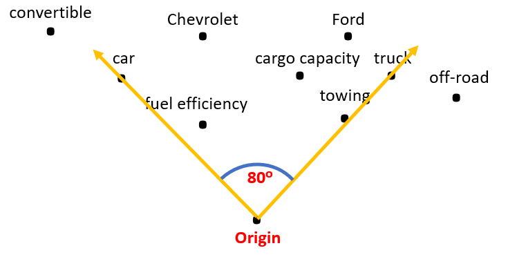
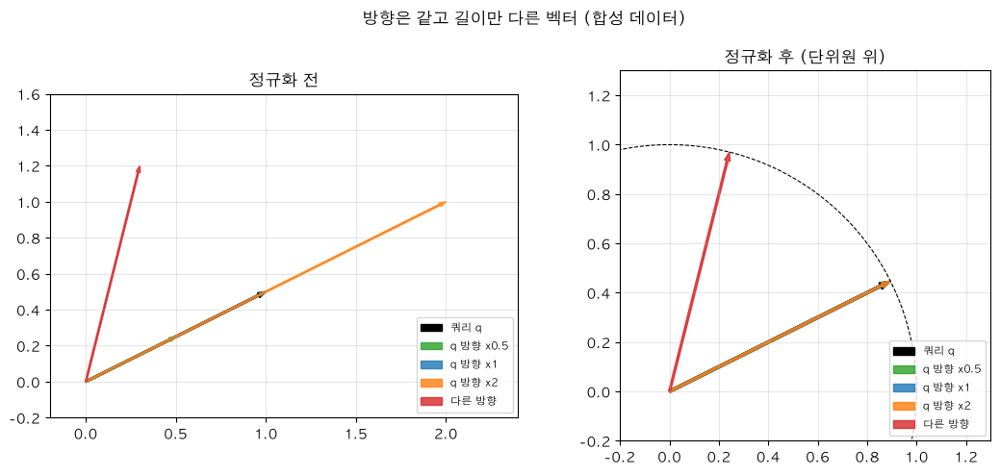
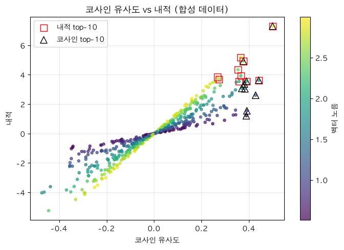
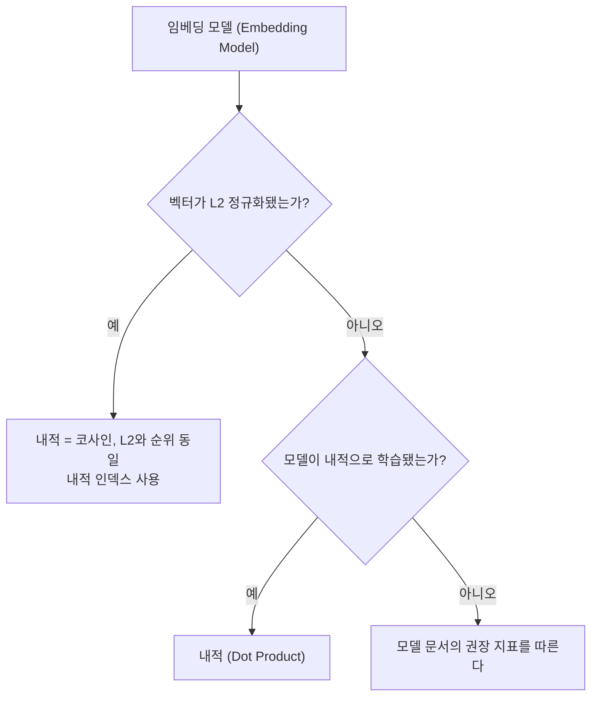

# 벡터 검색에서 유사도 지표가 중요한 이유

벡터 검색은 쿼리 벡터와 가장 "가까운" 문서 벡터를 찾는 작업이다. 그런데 "가깝다"를 무엇으로 재느냐에 따라 결과가 달라진다. 벡터 DB나 라이브러리는 인덱스를 만들 때 유사도 지표(metric)를 정하게 하는데, **같은 임베딩이라도 지표 설정에 따라 top-k 결과가 달라질 수 있다.**

[RAG 개념 정리](/posts/ai-rag-concept-masterclass/) 글에서는 코사인 유사도, 내적, 유클리드 거리를 한 줄씩만 소개했다. [RAG 검색 기법 총정리](/posts/ai-rag-retrieval-deep-dive/) 글의 실습 코드는 `normalize_embeddings=True`로 인코딩한 뒤 `np.dot`으로 계산한 값을 "코사인 유사도"라고 불렀다. 내적을 계산했는데 왜 코사인 유사도라고 할 수 있는지는 설명하지 않았다.

이 글에서는 세 지표의 정의와 수식, L2 정규화했을 때 세 지표의 순위가 같아지는 이유, 정규화 전후 순위 차이를 보여주는 합성 데이터 실험, FAISS·pgvector·Qdrant에서 지표를 지정하는 방법, 그리고 임베딩 모델에 맞춰 지표를 고르는 기준을 정리한다. ANN 인덱스 알고리즘(HNSW, IVF)과 맨해튼 거리 같은 다른 지표는 다루지 않는다.

&nbsp;

# 세 가지 유사도 지표

## 1. 코사인 유사도(Cosine Similarity)

### 개념

코사인 유사도는 두 벡터 사이의 **각도(방향)만 비교하고 길이는 무시한다.** 방향이 같으면 1, 직교하면 0, 반대 방향이면 -1이므로 값의 범위는 $[-1, 1]$이다. 값이 클수록 유사하다.


_출처: [StandingFuture, CosineSimilarity](https://commons.wikimedia.org/wiki/File:CosineSimilarity.png), CC BY-SA 4.0_

### 수식

$$
\cos(a, b) = \frac{a \cdot b}{\|a\| \, \|b\|}
$$

분모에서 두 벡터의 길이(노름, norm)로 나누기 때문에 벡터를 몇 배로 늘리거나 줄여도 값이 바뀌지 않는다.

---

## 2. 내적(Dot Product, Inner Product)

### 개념

내적은 방향과 길이(노름)를 **모두** 반영한다. 방향이 비슷할수록, 그리고 벡터가 길수록 값이 커진다. 값이 클수록 유사하다고 본다.

### 수식

$$
a \cdot b = \sum_{i=1}^{d} a_i b_i = \|a\| \, \|b\| \cos\theta
$$

기하학적으로는 $a$를 $b$ 방향으로 투영한 길이 $\|a\|\cos\theta$에 $\|b\|$를 곱한 값이다.


_출처: [Guy vandegrift, Projection simple](https://commons.wikimedia.org/wiki/File:Projection_simple.svg), CC BY-SA 4.0_

---

## 3. 유클리드 거리(Euclidean Distance, L2)

### 개념

유클리드 거리는 두 점 사이의 직선 거리다. 앞의 두 지표와 달리 **거리이므로 값이 작을수록 유사하다.** 방향과 길이 차이가 모두 거리에 반영된다.

### 수식

$$
\|a - b\| = \sqrt{\sum_{i=1}^{d} (a_i - b_i)^2}
$$

---

## 비교

| 지표 | 보는 것 | 유사할수록 | 노름 영향 |
| :--- | :--- | :---: | :---: |
| 코사인 유사도 | 방향(각도) | 값이 클수록 | 없음 |
| 내적 | 방향 + 길이 | 값이 클수록 | 있음 |
| 유클리드 거리 | 점 사이 직선 거리 | 값이 작을수록 | 있음 |

&nbsp;

# 세 지표의 관계: L2 정규화하면 순위가 같아진다

## 1. 전개 항등식

유클리드 거리의 제곱을 내적으로 전개하면 다음과 같다.

$$
\begin{aligned}
\|a - b\|^2 &= (a - b) \cdot (a - b) \\
&= a \cdot a - 2\, a \cdot b + b \cdot b \\
&= \|a\|^2 + \|b\|^2 - 2\, a \cdot b
\end{aligned}
$$

즉 L2 거리는 두 벡터의 노름과 내적으로 표현된다.

## 2. 단위 벡터일 때

L2 정규화(L2 normalization)는 벡터를 자기 노름으로 나눠 길이를 1로 만드는 것이다. $\|a\| = \|b\| = 1$이면 코사인 유사도의 분모가 1이 되고, 위 항등식의 노름 항도 1이 된다.

$$
\cos(a, b) = a \cdot b, \qquad \|a - b\|^2 = 2 - 2\cos(a, b)
$$

$2 - 2\cos$는 코사인이 클수록 작아지므로, **L2 정규화된 벡터에서는 L2 거리 오름차순, 코사인 유사도 내림차순, 내적 내림차순이 모두 같은 순위를 만든다.** FAISS 문서도 정규화된 벡터에서 $\|x - y\|^2 = 2 - 2\langle x, y \rangle$이므로 L2 인덱스와 내적 인덱스의 순위가 같다고 설명한다([Faiss wiki: MetricType and distances](https://github.com/facebookresearch/faiss/wiki/MetricType-and-distances)).

[RAG 검색 기법 총정리](/posts/ai-rag-retrieval-deep-dive/) 글의 코드가 `normalize_embeddings=True`로 인코딩한 뒤 `np.dot`의 결과를 코사인 유사도로 쓴 것도 이 관계 덕분이다.

## 3. 정규화하지 않으면

정규화하지 않은 벡터에서는 $a \cdot b = \|a\| \, \|b\| \cos\theta$이다. 쿼리 $q$의 노름 $\|q\|$는 모든 후보에 같은 배수로 곱해지므로 순위를 바꾸지 않는다. 반면 **DB 벡터의 노름은 후보마다 달라서 내적 순위에 영향을 준다.** FAISS 문서도 내적 검색에서 쿼리 노름은 순위에 영향이 없고 DB 벡터 노름은 영향이 있다고 설명한다.

L2 거리는 $\|a\|^2 + \|b\|^2 - 2\,a \cdot b$이므로 노름 차이를 거리로 반영한다. 결국 정규화하지 않으면 세 지표는 서로 다른 순위를 낼 수 있다.

&nbsp;

# 지표별 순위 비교 실습 (Jupyter Notebook)

실습은 numpy, scikit-learn, matplotlib만 사용하고 외부 API나 모델 다운로드는 쓰지 않는다.

## 1. 항등식 수치 검증

아래 실습의 모든 데이터는 시드를 고정한 **합성 데이터**이며, 실제 임베딩 모델의 결과가 아니다. 먼저 환경을 확인하고 세 지표 함수를 정의한다.


```python
import numpy as np
import sklearn
import matplotlib
import matplotlib.pyplot as plt
from sklearn.metrics.pairwise import cosine_similarity, cosine_distances, euclidean_distances
from sklearn.preprocessing import normalize

plt.rcParams['font.family'] = 'AppleGothic'
plt.rcParams['axes.unicode_minus'] = False

rng = np.random.default_rng(42)

def cosine(a, b):
    return a @ b / (np.linalg.norm(a) * np.linalg.norm(b))

def dot(a, b):
    return a @ b

def l2(a, b):
    return np.linalg.norm(a - b)
```


벡터 쌍 1000개(차원 64, 노름이 제각각)로 전개 항등식 $\|a-b\|^2 = \|a\|^2 + \|b\|^2 - 2a \cdot b$를 확인한다. 이어서 L2 정규화한 쌍에서 $\cos = a \cdot b$, $\|a-b\|^2 = 2 - 2\cos$도 확인한다.


```python
A = rng.normal(size=(1000, 64)) * rng.uniform(0.5, 3, size=(1000, 1))
B = rng.normal(size=(1000, 64)) * rng.uniform(0.5, 3, size=(1000, 1))

lhs = np.sum((A - B) ** 2, axis=1)
rhs = np.sum(A**2, axis=1) + np.sum(B**2, axis=1) - 2 * np.sum(A * B, axis=1)
print('||a-b||^2 == ||a||^2+||b||^2-2a.b :', np.allclose(lhs, rhs), '최대 오차', np.abs(lhs - rhs).max())

An, Bn = normalize(A), normalize(B)
cos_n = np.sum(An * Bn, axis=1)
dot_n = np.sum(An * Bn, axis=1)
sq_n = np.sum((An - Bn) ** 2, axis=1)
print('정규화 후 cos == dot             :', np.allclose(cos_n, dot_n), '최대 오차', np.abs(cos_n - dot_n).max())
print('정규화 후 ||a-b||^2 == 2-2cos    :', np.allclose(sq_n, 2 - 2 * cos_n), '최대 오차', np.abs(sq_n - (2 - 2 * cos_n)).max())
```

    ||a-b||^2 == ||a||^2+||b||^2-2a.b : True 최대 오차 2.2737367544323206e-13
    정규화 후 cos == dot             : True 최대 오차 0.0
    정규화 후 ||a-b||^2 == 2-2cos    : True 최대 오차 8.881784197001252e-16

세 관계 모두 `np.allclose`가 True이고 최대 오차는 부동소수점 오차 수준이다.


## 2. 방향은 같고 길이만 다른 벡터

쿼리와 같은 방향이고 길이가 0.5, 1, 2배인 벡터 3개와 다른 방향 벡터 1개를 비교한다.


```python
q = np.array([1.0, 0.5])
V = {
    'q 방향 x0.5': 0.5 * q,
    'q 방향 x1': 1.0 * q,
    'q 방향 x2': 2.0 * q,
    '다른 방향': np.array([0.3, 1.2]),
}
print(f"{'벡터':<12}{'cosine':>8}{'dot':>8}{'L2':>8}")
for name, v in V.items():
    print(f"{name:<12}{cosine(q, v):8.3f}{dot(q, v):8.3f}{l2(q, v):8.3f}")

fig, axes = plt.subplots(1, 2, figsize=(11, 5))
colors = ['tab:green', 'tab:blue', 'tab:orange', 'tab:red']
theta = np.linspace(0, 2 * np.pi, 200)
for ax, norm_on in zip(axes, [False, True]):
    ax.arrow(0, 0, *q / (np.linalg.norm(q) if norm_on else 1), color='black', width=0.01, length_includes_head=True, label='쿼리 q')
    for (name, v), c in zip(V.items(), colors):
        w = v / np.linalg.norm(v) if norm_on else v
        ax.arrow(0, 0, *w, color=c, width=0.008, length_includes_head=True, alpha=0.8, label=name)
    if norm_on:
        ax.plot(np.cos(theta), np.sin(theta), 'k--', lw=0.8)
    ax.set_aspect('equal'); ax.set_xlim(-0.2, 2.4 if not norm_on else 1.3); ax.set_ylim(-0.2, 1.6 if not norm_on else 1.3)
    ax.set_title('정규화 후 (단위원 위)' if norm_on else '정규화 전'); ax.grid(alpha=0.3); ax.legend(loc='lower right', fontsize=8)
fig.suptitle('방향은 같고 길이만 다른 벡터 (합성 데이터)')
plt.tight_layout()
plt.show()
```

    벡터            cosine     dot      L2
    q 방향 x0.5      1.000   0.625   0.559
    q 방향 x1        1.000   1.250   0.000
    q 방향 x2        1.000   2.500   1.118
    다른 방향          0.651   0.900   0.990


    

    

세 벡터 모두 코사인 유사도는 1.000으로 같지만, 내적은 길이에 비례해 0.625, 1.250, 2.500으로 커진다. 내적 기준으로는 다른 방향 벡터(0.900)가 같은 방향의 0.5배 벡터(0.625)보다 앞서고, L2 기준으로는 2배 벡터(1.118)가 다른 방향 벡터(0.990)보다 멀다.


## 3. 정규화 전후 top-k 순위 비교

500개 × 32차원 합성 코퍼스를 만든다. 방향은 정규분포에서 뽑고, 노름은 0.5~3 범위로 일부러 다르게 스케일한다.


```python
N, D, K = 500, 32, 10
X = rng.normal(size=(N, D))
X = normalize(X) * rng.uniform(0.5, 3, size=(N, 1))
q = rng.normal(size=(1, D))

norms = np.linalg.norm(X, axis=1)
print(f'코퍼스 노름 min/mean/max: {norms.min():.3f} / {norms.mean():.3f} / {norms.max():.3f}')
print(f'쿼리 노름: {np.linalg.norm(q):.3f}')
```

    코퍼스 노름 min/mean/max: 0.510 / 1.759 / 3.000
    쿼리 노름: 4.988


```python
def topk_tables(X, q, k=K):
    cos = cosine_similarity(q, X)[0]
    dt = (X @ q.T).ravel()
    dist = euclidean_distances(q, X)[0]
    tops = {'cosine': np.argsort(-cos)[:k], 'dot': np.argsort(-dt)[:k], 'L2': np.argsort(dist)[:k]}
    print(f"{'순위':<4}" + ''.join(f'{n:>8}' for n in tops))
    for r in range(k):
        print(f'{r + 1:<4}' + ''.join(f'{t[r]:>8}' for t in tops.values()))
    ov = lambda a, b: len(set(tops[a]) & set(tops[b]))
    print(f"겹침 cos∩dot={ov('cosine', 'dot')}, cos∩L2={ov('cosine', 'L2')}, dot∩L2={ov('dot', 'L2')}")
    return tops

print('[정규화 전]')
t0 = topk_tables(X, q)
print()
print('[L2 정규화 후]')
t1 = topk_tables(normalize(X), normalize(q))
print()
print('정규화 후 세 순위 완전 일치:', np.array_equal(t1['cosine'], t1['dot']) and np.array_equal(t1['cosine'], t1['L2']))
```

    [정규화 전]
    순위    cosine     dot      L2
    1        338     338     338
    2        345     114     345
    3        324     262      82
    4        491     329     324
    5         82     234     267
    6         38     339      53
    7         53     356      26
    8        267     345     234
    9        262      82     377
    10        26     377     262
    겹침 cos∩dot=4, cos∩L2=8, dot∩L2=6
    
    [L2 정규화 후]
    순위    cosine     dot      L2
    1        338     338     338
    2        345     345     345
    3        324     324     324
    4        491     491     491
    5         82      82      82
    6         38      38      38
    7         53      53      53
    8        267     267     267
    9        262     262     262
    10        26      26      26
    겹침 cos∩dot=10, cos∩L2=10, dot∩L2=10
    
    정규화 후 세 순위 완전 일치: True

정규화 전에는 1위(338번)만 세 지표가 같고, top-10 겹침은 코사인과 내적이 4개, 코사인과 L2가 8개, 내적과 L2가 6개였다. L2 정규화한 뒤에는 세 지표의 top-10이 순서까지 모두 같았다.


## 4. 내적의 노름 편향

정규화하지 않은 코퍼스에서 내적 top-10이 노름이 큰 벡터에 몰리는지 확인한다.


```python
cos = cosine_similarity(q, X)[0]
dt = (X @ q.T).ravel()
print(f'코퍼스 평균 노름: {norms.mean():.3f}')
for name, idx in t0.items():
    print(f'{name:<7} top-10 평균 노름: {norms[idx].mean():.3f}')

fig, ax = plt.subplots(figsize=(7, 5))
sc = ax.scatter(cos, dt, c=norms, cmap='viridis', s=14, alpha=0.7)
ax.scatter(cos[t0['dot']], dt[t0['dot']], marker='s', facecolors='none', edgecolors='red', s=90, label='내적 top-10')
ax.scatter(cos[t0['cosine']], dt[t0['cosine']], marker='^', facecolors='none', edgecolors='black', s=90, label='코사인 top-10')
fig.colorbar(sc, label='벡터 노름')
ax.set_xlabel('코사인 유사도'); ax.set_ylabel('내적')
ax.set_title('코사인 유사도 vs 내적 (합성 데이터)')
ax.legend(); ax.grid(alpha=0.3)
plt.tight_layout()
plt.show()
```

    코퍼스 평균 노름: 1.759
    cosine  top-10 평균 노름: 1.668
    dot     top-10 평균 노름: 2.404
    L2      top-10 평균 노름: 1.940


    

    

정규화하지 않은 코퍼스에서 코사인 top-10의 평균 노름(1.668)은 코퍼스 평균(1.759)과 비슷하지만, 내적 top-10의 평균 노름은 2.404로 높다. **정규화하지 않으면 내적 검색은 방향이 조금 덜 맞더라도 노름이 큰 벡터를 위로 올린다.** 다만 이 수치는 합성 데이터에서 나온 것이며 실제 임베딩 모델의 검색 품질을 뜻하지 않는다.


## 5. 거리와 유사도의 부호 변환

정규화한 후보 5개로 코사인 거리(`1 - cos`), pgvector `<#>`처럼 부호를 뒤집은 내적, FAISS `METRIC_L2`처럼 제곱 L2를 반환하는 경우를 비교한다.


```python
Xn, qn = normalize(X[:5]), normalize(q)
cos5 = cosine_similarity(qn, Xn)[0]
dot5 = (Xn @ qn.T).ravel()
sq5 = euclidean_distances(qn, Xn, squared=True)[0]
l25 = np.sqrt(sq5)

cols = {'cos': cos5, '1-cos': 1 - cos5, '-dot': -dot5, 'L2^2': sq5, 'L2': l25}
print(''.join(f'{c:>9}' for c in cols))
for i in range(5):
    print(''.join(f'{v[i]:9.4f}' for v in cols.values()))

print()
print('1-cos == sklearn cosine_distances:', np.allclose(1 - cos5, cosine_distances(qn, Xn)[0]))
orders = {'cos 내림차순': np.argsort(-cos5), '1-cos 오름차순': np.argsort(1 - cos5), '-dot 오름차순': np.argsort(-dot5),
          'L2^2 오름차순': np.argsort(sq5), 'L2 오름차순': np.argsort(l25)}
for n, o in orders.items():
    print(f'{n:<16}', o)
print('모든 정렬 순서 동일:', all(np.array_equal(o, orders['cos 내림차순']) for o in orders.values()))
```

          cos    1-cos     -dot     L2^2       L2
      -0.0110   1.0110   0.0110   2.0220   1.4220
      -0.1068   1.1068   0.1068   2.2135   1.4878
       0.0735   0.9265  -0.0735   1.8531   1.3613
      -0.0445   1.0445   0.0445   2.0891   1.4454
       0.2802   0.7198  -0.2802   1.4395   1.1998
    
    1-cos == sklearn cosine_distances: True
    cos 내림차순         [4 2 0 3 1]
    1-cos 오름차순       [4 2 0 3 1]
    -dot 오름차순        [4 2 0 3 1]
    L2^2 오름차순        [4 2 0 3 1]
    L2 오름차순          [4 2 0 3 1]
    모든 정렬 순서 동일: True

마지막 실습에서는 정규화한 벡터에서 코사인 거리(`1-cos`), 부호를 뒤집은 내적(`-dot`), 제곱 L2, L2로 오름차순 정렬한 순서가 모두 코사인 내림차순과 같았다. 거리 계열 값은 작을수록, 유사도 계열 값은 클수록 가깝다는 방향만 맞추면 된다.

&nbsp;

# 벡터 DB와 라이브러리에서 지표 지정하기

## 1. FAISS

FAISS는 지표를 자동으로 고르지 않는다. 인덱스를 만들 때 사용자가 지정하며, 기본 옵션은 `METRIC_L2`와 `METRIC_INNER_PRODUCT`다([Faiss wiki: MetricType and distances](https://github.com/facebookresearch/faiss/wiki/MetricType-and-distances)).

- `METRIC_L2`는 **제곱** 유클리드 거리를 반환한다(제곱근 생략). 실제 거리가 필요하면 직접 제곱근을 취한다. 순위는 같다(실습 5의 `L2^2 오름차순` 참고).
- `METRIC_INNER_PRODUCT`로 코사인 유사도를 계산하려면 DB 벡터와 쿼리 벡터를 모두 `faiss.normalize_L2`로 정규화한 뒤 내적 인덱스를 쓴다.

아래는 예시 코드이며 이 글에서 실행하지 않았다.

```python
import faiss

d = xb.shape[1]  # xb: DB 벡터(float32), xq: 쿼리 벡터(float32)

# 코사인 유사도: 정규화 후 내적 인덱스
# normalize_L2는 float32 배열을 받아 입력 배열을 in-place로 바꾼다
faiss.normalize_L2(xb)
faiss.normalize_L2(xq)
index_ip = faiss.IndexFlatIP(d)
index_ip.add(xb)
scores, ids = index_ip.search(xq, 10)

# L2: 반환값은 제곱 거리
index_l2 = faiss.IndexFlatL2(d)
index_l2.add(xb)
sq_dists, ids = index_l2.search(xq, 10)
```

---

## 2. pgvector

pgvector는 연산자로 지표를 고른다([pgvector README](https://github.com/pgvector/pgvector), 문서 기준 v0.8.7).

| 연산자 | 의미 | 정렬 |
| :---: | :--- | :---: |
| `<->` | L2 거리 | 오름차순 |
| `<#>` | 음의 내적(negative inner product) | 오름차순 |
| `<=>` | 코사인 거리, 코사인 유사도 = `1 - (a <=> b)` | 오름차순 |

`<#>`는 내적에 -1을 곱한 값이다. Postgres가 인덱스에서 오름차순 스캔만 지원하기 때문이다. **`<#>` 값은 작을수록(더 음수일수록) 가깝다**는 점을 놓치기 쉽다. 내적 자체가 필요하면 `(a <#> b) * -1`로 되돌린다.

인덱스는 HNSW, IVFFlat 모두 `vector_l2_ops`, `vector_ip_ops`, `vector_cosine_ops` opclass를 쓴다. 쿼리의 연산자와 인덱스 opclass가 맞아야 인덱스를 탄다.

```sql
-- 코사인 거리용 인덱스와 쿼리 (연산자와 opclass를 맞춘다)
CREATE INDEX ON items USING hnsw (embedding vector_cosine_ops);
SELECT id FROM items ORDER BY embedding <=> '[0.1, 0.2, 0.3]' LIMIT 5;
```

---

## 3. Qdrant

Qdrant는 컬렉션을 만들 때 벡터 설정에 거리를 지정한다. 선택지는 `Dot`, `Cosine`, `Euclid`, `Manhattan`이다([Qdrant Documentation: Collections](https://qdrant.tech/documentation/concepts/collections/)).

```json
{
  "vectors": {
    "size": 300,
    "distance": "Cosine"
  }
}
```

문서에 따르면 `Cosine`은 정규화된 벡터 위의 내적으로 구현되며, 업로드할 때 벡터가 자동으로 정규화된다. 앞에서 본 "정규화 후 내적 = 코사인" 관계를 DB가 대신 처리하는 셈이다.

---

## 요약

| 라이브러리 | L2 | 내적 | 코사인 | 주의점 |
| :--- | :---: | :---: | :---: | :--- |
| FAISS | `METRIC_L2` | `METRIC_INNER_PRODUCT` | 정규화 후 내적 | L2는 제곱 거리 반환 |
| pgvector | `<->` | `<#>` | `<=>` | `<#>`는 음의 내적, 연산자와 opclass 일치 |
| Qdrant | `Euclid` | `Dot` | `Cosine` | `Cosine`은 업로드 시 자동 정규화 |

&nbsp;

# 어떤 지표를 고를까

Qdrant 문서는 적절한 지표가 인코더 모델의 학습 방식에 달려 있다고 안내한다. 즉 **지표는 임베딩 모델이 학습된 방식과 출력 벡터의 정규화 여부에 맞춰 고른다.** 모델 쪽 문서에서 확인할 수 있는 사실은 다음과 같다.

- **sentence-transformers**: `encode()`의 `normalize_embeddings`는 반환 벡터를 길이 1로 정규화할지 정하는 옵션이고 기본값은 `False`다. `similarity_fn_name`을 지정하지 않으면 `similarity()`를 처음 호출할 때 cosine으로 설정된다(선택지: cosine, dot, euclidean, manhattan). 기본값에서는 `encode()`가 정규화를 강제하지 않으므로 모델에 따라 노름이 1이 아닐 수 있다. 내적 인덱스를 쓰려면 `normalize_embeddings=True`로 인코딩하거나 출력 노름을 직접 확인한다.
- **OpenAI 임베딩**: 길이 1로 정규화돼 있어 코사인 유사도를 내적으로 더 빠르게 계산할 수 있고, 유클리드 거리와도 같은 순위를 낸다. 거리 함수로는 코사인을 권장하지만 어떤 것을 골라도 큰 차이는 없다는 취지로 안내한다.



실무에서는 다음 순서로 확인한다.

1. 모델 문서나 모델 카드에서 권장 지표를 확인한다.
2. 출력 벡터의 노름을 확인한다. 실습 3처럼 `np.linalg.norm(X, axis=1)`로 노름 분포를 보면 정규화 여부를 바로 알 수 있다.
3. 정규화돼 있으면 연산이 가장 단순한 내적을 쓴다. 정규화돼 있지 않으면 코사인을 쓰거나, 저장 전에 정규화한 뒤 내적을 쓴다.
4. 인덱스의 metric(또는 opclass)과 쿼리 연산자가 같은 지표인지 맞춘다.

&nbsp;

# 정리

1. **L2 정규화된 벡터에서는 세 지표의 순위가 같다.**
   $\cos = a \cdot b$, $\|a - b\|^2 = 2 - 2\cos$이므로 어떤 지표로 정렬해도 같은 top-k가 나온다. 실습에서도 정규화 후 세 지표의 top-10이 완전히 일치했다.
2. **정규화하지 않으면 내적은 DB 벡터의 노름에 끌려간다.**
   쿼리 노름은 순위에 영향이 없지만 DB 벡터 노름은 영향을 준다. 합성 데이터 실습에서 내적 top-10의 평균 노름은 코퍼스 평균보다 높았다.
3. **거리는 작을수록, 유사도는 클수록 가깝다.**
   코사인 거리 `1 - cos`, pgvector `<#>`의 음의 내적, FAISS `METRIC_L2`의 제곱 거리처럼 부호와 방향이 바뀐 값을 쓸 때 정렬 방향을 확인한다.
4. **지표는 임베딩 모델과 DB 설정을 함께 보고 고른다.**
   모델의 학습 방식과 정규화 여부를 확인하고, 인덱스 metric과 쿼리 연산자를 같은 지표로 맞춘다.

참고자료

- [Faiss wiki: MetricType and distances](https://github.com/facebookresearch/faiss/wiki/MetricType-and-distances)
- [Faiss wiki: Getting started](https://github.com/facebookresearch/faiss/wiki/Getting-started)
- [pgvector README](https://github.com/pgvector/pgvector)
- [Qdrant Documentation: Collections](https://qdrant.tech/documentation/concepts/collections/)
- [Sentence Transformers: SentenceTransformer API](https://sbert.net/docs/package_reference/sentence_transformer/SentenceTransformer.html)
- [OpenAI Embeddings guide](https://developers.openai.com/api/docs/guides/embeddings)
