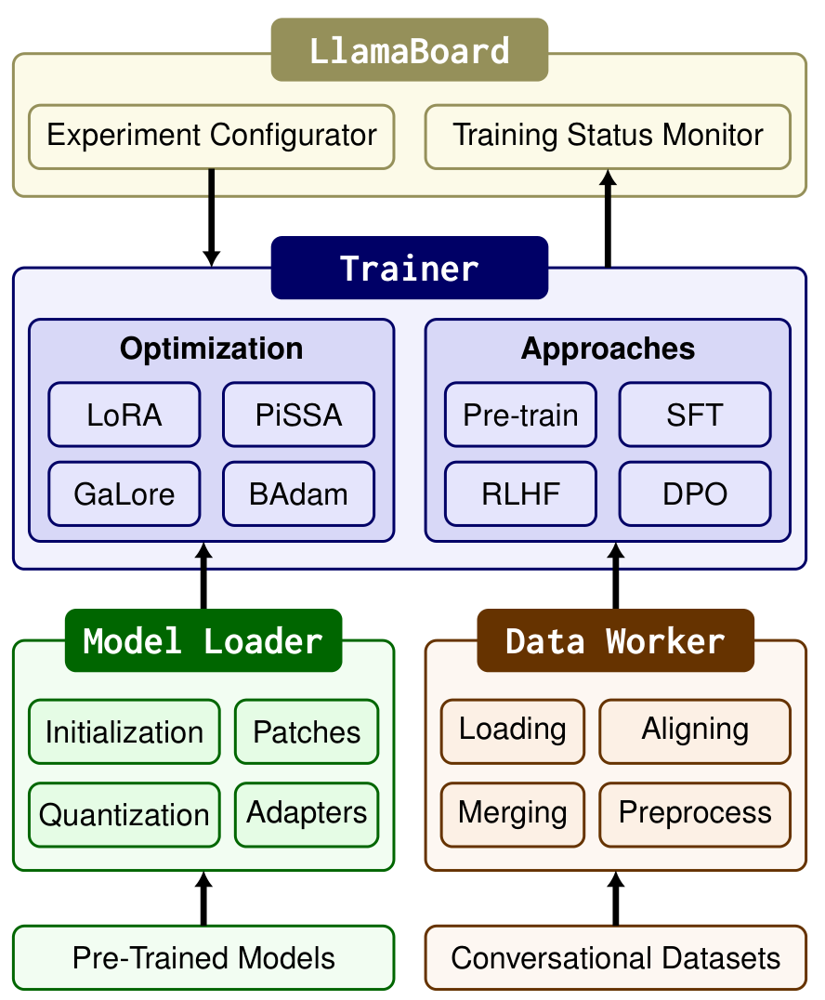
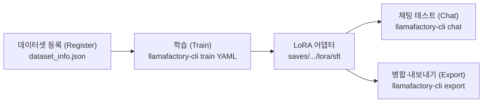
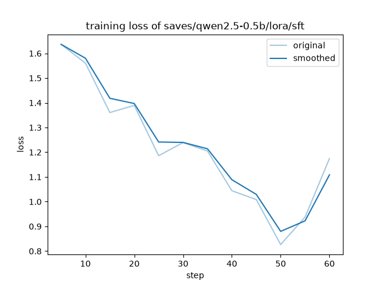

# 파인튜닝 코드를 설정 파일로 바꾸기

[QLoRA 글](/posts/ai-qlora/)에서는 `BitsAndBytesConfig`, `LoraConfig`, `SFTTrainer`를 transformers·peft·TRL로 직접 엮어 학습 코드를 짰다. 모델을 바꾸거나 데이터 형식을 바꿀 때마다 이 코드를 다시 손봐야 한다.

LlamaFactory는 이 과정을 설정 파일 중심으로 바꾼다. **학습 방법, 데이터셋, 출력 경로, 하이퍼파라미터를 YAML 한 장에 적고 `llamafactory-cli train`으로 실행한다.** 채팅 테스트는 `llamafactory-cli chat`, 어댑터 병합은 `llamafactory-cli export`로 이어진다. 저장소 라이선스는 Apache-2.0이고, 모델 가중치에는 각 모델의 라이선스가 따로 적용된다.

LlamaFactory는 ACL 2024 System Demonstrations에 실린 논문 [Zheng et al., "LlamaFactory: Unified Efficient Fine-Tuning of 100+ Language Models"](https://aclanthology.org/2024.acl-demos.38/)로도 소개됐다. 논문 Figure 1은 프레임워크를 세 모듈과 웹 UI로 나눠 보여 준다. LlamaBoard(웹 UI)가 설정을 Trainer에 넘기고, Trainer는 Model Loader에서 모델을, Data Worker에서 데이터를 받는다.


_출처: [Zheng et al., "LlamaFactory: Unified Efficient Fine-Tuning of 100+ Language Models", ACL 2024 System Demonstrations, Figure 1](https://aclanthology.org/2024.acl-demos.38/), CC BY 4.0_

CLI로 쓰면 이 구조가 다음 흐름이 된다. YAML은 Trainer에 넘기는 설정이고, `dataset_info.json`은 Data Worker가 데이터셋 이름을 찾는 목록이다.



편해지는 만큼 옵션의 의미는 직접 알아야 한다. `template`이 모델과 맞지 않거나, `lora_target`, `cutoff_len`을 잘못 두면 코드 오류 없이 학습 결과만 달라진다.

이 글에서는 LlamaFactory 설치와 CLI 명령, `dataset_info.json`에 alpaca·sharegpt 데이터셋을 등록하는 방법, 공식 LoRA SFT 예제 YAML 읽는 법을 정리한다. 이어서 Apple M5 Mac에서 Qwen2.5-0.5B-Instruct를 실제로 LoRA 학습·병합한 결과를 싣고, QLoRA로 바꾸는 옵션과 주요 옵션 표를 정리한다.

&nbsp;

# 설치와 CLI 명령

## 설치

README는 소스 클론 후 editable 설치를 안내한다. Python은 3.11 이상이 필요하다.

```bash
git clone --depth 1 https://github.com/hiyouga/LlamaFactory.git
cd LlamaFactory
pip install -e .
pip install -r requirements/metrics.txt
```

이 글의 실습은 v0.9.5 태그를 클론해 설치했다. DeepSpeed나 Ascend NPU를 쓰면 `requirements/deepspeed.txt`, `requirements/npu.txt`를 추가로 설치한다.


## llamafactory-cli 하위 명령

설치하면 `llamafactory-cli`와 별칭 `lmf` 두 명령이 생긴다. 하위 명령은 `launcher.py`에 정의돼 있다.

| 명령 | 하는 일 |
| :--- | :--- |
| `train` | YAML로 학습을 실행한다. 장치가 여러 개이거나 `FORCE_TORCHRUN`을 설정하면 torchrun으로 분산 실행한다. |
| `chat` | CLI에서 대화형으로 채팅한다. |
| `export` | LoRA 어댑터를 병합하고 모델을 내보낸다. |
| `api` | OpenAI 스타일 API 서버를 띄운다. |
| `webchat` | 웹 채팅 화면을 띄운다. |
| `webui` | LlamaBoard(Gradio) 웹 UI를 띄운다. |
| `env` | 설치 환경 정보를 출력한다. |
| `version` | 버전 배너를 출력한다. |
| `help` | 사용법을 출력한다. |

`eval` 명령도 코드에 남아 있지만 `NotImplementedError`를 내므로 쓸 수 없다.

&nbsp;

# 데이터셋 등록: dataset_info.json

## 등록 구조

LlamaFactory는 YAML의 `dataset:`에 파일 경로가 아니라 **등록된 이름**을 받는다. 이름과 파일의 대응은 `dataset_dir`(기본값 `data`) 아래 `dataset_info.json`에 적는다. [data/README.md](https://github.com/hiyouga/LlamaFactory/blob/main/data/README.md)는 alpaca와 sharegpt 두 형식을 지원하고, 파일은 json, jsonl, csv, parquet, arrow를 받는다고 적었다.

| 필드 | 의미 | 기본값 |
| :--- | :--- | :---: |
| `file_name` | `dataset_dir` 안의 파일 또는 폴더 이름 | 다른 소스가 없으면 필수 |
| `hf_hub_url` / `ms_hub_url` | Hugging Face·ModelScope 데이터셋 저장소 이름. 지정하면 `file_name`보다 우선한다. | - |
| `formatting` | 데이터 형식 | `alpaca` |
| `ranking` | 선호(preference) 데이터셋 여부 | `False` |
| `split` | 사용할 split | `train` |
| `num_samples` | 사용할 샘플 수 | `None` |
| `columns` | 데이터 열 이름과 LlamaFactory 역할의 대응 | 형식별 기본값 |
| `tags` | sharegpt 메시지의 역할 키·값 | `from`, `value`, `human`, `gpt` 등 |

## alpaca 형식

alpaca 형식은 레코드마다 `instruction`, `input`, `output`을 둔다. data/README.md에 따르면 SFT에서는 `instruction`과 `input`을 `instruction\ninput`으로 이어 사용자 프롬프트로 쓰고, `output`을 모델 응답으로 학습한다. 실습에 쓴 `identity.json`의 레코드 하나는 다음과 같다.

```json
{"instruction": "What is your name?", "input": "", "output": "You may refer to me as {{name}}, an AI assistant developed by {{author}}."}
```

`columns` 기본값이 `prompt=instruction`, `query=input`, `response=output`이라서, 열 이름이 같으면 등록은 `file_name` 한 줄로 끝난다. 내장 데이터셋도 이렇게 등록돼 있다.

```json
{
  "identity": {
    "file_name": "identity.json"
  },
  "alpaca_en_demo": {
    "file_name": "alpaca_en_demo.json"
  }
}
```

`system`, `history` 열도 쓸 수 있다. `history`에 넣은 이전 턴의 응답도 SFT에서 학습 대상이 된다는 점은 data/README.md가 따로 강조한다.

## sharegpt 형식

sharegpt 형식은 `conversations` 열에 메시지 목록을 둔다. human, gpt 외에 observation, function_call 같은 역할도 넣을 수 있다. data/README.md의 예시는 다음과 같다.

```json
[
  {
    "conversations": [
      {
        "from": "human",
        "value": "user instruction"
      },
      {
        "from": "function_call",
        "value": "tool arguments"
      },
      {
        "from": "observation",
        "value": "tool result"
      },
      {
        "from": "gpt",
        "value": "model response"
      }
    ],
    "system": "system prompt (optional)",
    "tools": "tool description (optional)"
  }
]
```

human과 observation은 홀수 번째, gpt와 function_call은 짝수 번째에 와야 하고, 모델이 학습하는 쪽은 gpt와 function_call이다. 등록할 때는 `formatting`을 `sharegpt`로 바꾸고 `columns`에 `messages`를 지정한다.

```json
"dataset_name": {
  "file_name": "data.json",
  "formatting": "sharegpt",
  "columns": {
    "messages": "conversations",
    "system": "system",
    "tools": "tools"
  }
}
```

`role`/`content`/`user`/`assistant` 키를 쓰는 OpenAI 스타일 `messages` 데이터는 sharegpt의 특수한 경우로 취급한다. 이때는 `columns.messages`를 `messages`로 두고 `tags`에 `role_tag: role`, `content_tag: content`, `user_tag: user`, `assistant_tag: assistant`, `system_tag: system`을 지정한다.

## alpaca와 sharegpt 비교

| 항목 | alpaca | sharegpt |
| :--- | :--- | :--- |
| 구조 | 레코드당 `instruction`/`input`/`output` 열 | `conversations` 열의 메시지 목록 |
| 멀티턴 | `history` 열로 이전 턴 표현 | 메시지 목록 자체가 멀티턴 |
| 역할 | 사용자·응답(+system) | human, gpt, observation, function_call, system |
| 등록 | 열 이름이 기본값이면 `file_name`만 | `formatting: sharegpt`와 `columns.messages` 필요 |
| 맞는 경우 | 단일 턴 지시-응답 데이터 | 대화 로그, 도구 호출 데이터 |

## identity 데이터의 플레이스홀더

내장 `identity.json`(91건)의 응답에는 `{{name}}`, `{{author}}` 자리표시자가 들어 있다. 그대로 학습하면 모델이 이 문자열을 답하도록 배울 수 있으므로, 실습에서는 값을 직접 치환한 새 파일을 만들어 등록했다.

&nbsp;

# LoRA SFT YAML 읽기

공식 예제 [examples/train_lora/qwen3_lora_sft.yaml](https://github.com/hiyouga/LlamaFactory/blob/v0.9.5/examples/train_lora/qwen3_lora_sft.yaml)의 v0.9.5 원문이다.

```yaml
### model
model_name_or_path: Qwen/Qwen3-4B-Instruct-2507
trust_remote_code: true

### method
stage: sft
do_train: true
finetuning_type: lora
lora_rank: 8
lora_target: all

### dataset
dataset: identity,alpaca_en_demo
template: qwen3_nothink
cutoff_len: 2048
max_samples: 1000
preprocessing_num_workers: 16
dataloader_num_workers: 4

### output
output_dir: saves/qwen3-4b/lora/sft
logging_steps: 10
save_steps: 500
plot_loss: true
overwrite_output_dir: true
save_only_model: false
report_to: none  # choices: [none, wandb, tensorboard, swanlab, mlflow]

### train
per_device_train_batch_size: 1
gradient_accumulation_steps: 8
learning_rate: 1.0e-4
num_train_epochs: 3.0
lr_scheduler_type: cosine
warmup_ratio: 0.1
bf16: true
ddp_timeout: 180000000
resume_from_checkpoint: null

### eval
# eval_dataset: alpaca_en_demo
# val_size: 0.1
# per_device_eval_batch_size: 1
# eval_strategy: steps
# eval_steps: 500
```

```bash
llamafactory-cli train examples/train_lora/qwen3_lora_sft.yaml
```

블록별로 보면 다음과 같다.

- **model**: 학습할 base 모델이다. Hugging Face·ModelScope 식별자나 로컬 경로를 받는다.
- **method**: `stage: sft`는 지도 미세조정, `finetuning_type: lora`는 LoRA 어댑터 학습이다. `lora_target: all`은 모든 선형 모듈에 LoRA를 붙인다. `lora_alpha`를 비워 두면 소스에서 `lora_rank * 2`로 채운다.
- **dataset**: `dataset`은 `dataset_info.json`에 등록한 이름을 쉼표로 나열한다. `template`은 모델의 채팅 형식(역할 토큰, 종료 토큰, 기본 system 프롬프트)을 정한다. README는 "Remember to use the **SAME** template in training and inference."라고 적어, 학습과 추론에 같은 template을 쓰라고 강조한다.
- **output**: `plot_loss: true`면 학습 후 loss 곡선 이미지를 저장한다. `overwrite_output_dir`는 예제에 들어 있지만 `training_args.py`에서는 deprecated로 표시돼 있다.
- **train**: 배치 1 × 누적 8로 유효 배치 8, 학습률 1e-4, cosine 스케줄, bf16이다.
- **eval**: 주석으로 남겨 둔 검증 설정이다. 쓰려면 주석을 풀고 `val_size`나 `eval_dataset`을 지정한다.

&nbsp;

# LlamaFactory 실습 (Jupyter Notebook)


## 1. 환경 확인


```python
import os, sys, subprocess, json, random, platform
import numpy as np, torch
os.environ["PYTORCH_ENABLE_MPS_FALLBACK"] = "1"
os.environ["LLAMAFACTORY_VERBOSITY"] = "WARN"; os.environ["TQDM_DISABLE"] = "1"
import warnings; warnings.filterwarnings("ignore")
os.chdir("LlamaFactory")          # v0.9.5 태그로 clone한 LlamaFactory 루트
random.seed(42); np.random.seed(42); torch.manual_seed(42)

def sh(cmd, log=None):
    """셸 명령을 실행하고 전체 출력을 반환한다. log를 주면 파일로도 저장한다."""
    p = subprocess.run(cmd, shell=True, capture_output=True, text=True, env=os.environ)
    out = p.stdout + p.stderr
    if log: open(log, "w").write(out)
    if p.returncode: raise RuntimeError(f"exit {p.returncode}: {cmd}\n{out[-3000:]}")
    return out

import transformers, peft, trl, llamafactory
print("python      ", sys.version.split()[0])
print("torch       ", torch.__version__)
print("transformers", transformers.__version__)
print("peft        ", peft.__version__)
print("trl         ", trl.__version__)
print("llamafactory", llamafactory.__version__ if hasattr(llamafactory, "__version__") else "-")
print("MPS built/available:", torch.backends.mps.is_built(), torch.backends.mps.is_available())
print("CUDA available:", torch.cuda.is_available())
print("PYTORCH_ENABLE_MPS_FALLBACK =", os.environ["PYTORCH_ENABLE_MPS_FALLBACK"])
print("chip        ", sh("sysctl -n machdep.cpu.brand_string").strip())
print("memory (GB) ", int(sh("sysctl -n hw.memsize")) // 2**30)
print("macOS       ", platform.mac_ver()[0])
```

    python       3.12.13
    torch        2.15.0
    transformers 5.6.0
    peft         0.18.1
    trl          0.24.0
    llamafactory 0.9.5
    MPS built/available: True True
    CUDA available: False
    PYTORCH_ENABLE_MPS_FALLBACK = 1
    chip         Apple M5
    memory (GB)  24
    macOS        27.2.1

```python
print(sh("llamafactory-cli version"))
print(sh("llamafactory-cli env"))
```

    ----------------------------------------------------------
    | Welcome to LLaMA Factory, version 0.9.5                |
    |                                                        |
    | Project page: https://github.com/hiyouga/LLaMA-Factory |
    ----------------------------------------------------------

    - `llamafactory` version: 0.9.5
    - Platform: macOS-27.2.1-arm64-arm-64bit
    - Python version: 3.12.13
    - PyTorch version: 2.15.0
    - Transformers version: 5.6.0
    - Datasets version: 4.0.0
    - Accelerate version: 1.11.0
    - PEFT version: 0.18.1
    - TRL version: 0.24.0
    - Git commit: 7af909522a951e3ad9f022ea6f88b6755257eaa5
    - Default data directory: detected

`env` 출력에는 장치 항목이 없다. `env.py`는 CUDA, NPU 같은 가속기만 감지하므로 MPS는 표시되지 않는다.

## 2. 데이터 준비

`identity.json`의 플레이스홀더를 예시 이름으로 바꿔 `identity_custom.json`으로 저장한다.

```python
src = json.load(open("data/identity.json"))
print("레코드 수:", len(src))
print("치환 전:", json.dumps(src[3], ensure_ascii=False))

NAME, AUTHOR = "Mac-Assistant", "Grant Blog"
text = open("data/identity.json").read().replace("{{name}}", NAME).replace("{{author}}", AUTHOR)
open("data/identity_custom.json", "w").write(text)
dst = json.loads(text)
print("치환 후:", json.dumps(dst[3], ensure_ascii=False))
print("남은 플레이스홀더:", text.count("{{"))
```

    레코드 수: 91
    치환 전: {"instruction": "What is your name?", "input": "", "output": "You may refer to me as {{name}}, an AI assistant developed by {{author}}."}
    치환 후: {"instruction": "What is your name?", "input": "", "output": "You may refer to me as Mac-Assistant, an AI assistant developed by Grant Blog."}
    남은 플레이스홀더: 0

새 파일을 `dataset_info.json`에 `identity_custom`이라는 이름으로 등록한다. alpaca 기본 열 이름을 그대로 쓰므로 `file_name`만 적으면 된다.

```python
info_path = "data/dataset_info.json"
info = json.load(open(info_path))
info["identity_custom"] = {"file_name": "identity_custom.json"}
json.dump(info, open(info_path, "w"), indent=2, ensure_ascii=False)
print(json.dumps({k: info[k] for k in ("identity", "identity_custom", "alpaca_en_demo")}, indent=2))
```

    {
      "identity": {
        "file_name": "identity.json"
      },
      "identity_custom": {
        "file_name": "identity_custom.json"
      },
      "alpaca_en_demo": {
        "file_name": "alpaca_en_demo.json"
      }
    }

## 3. Mac용 학습 YAML


```python
yaml_text = """\
### model
model_name_or_path: Qwen/Qwen2.5-0.5B-Instruct

### method
stage: sft
do_train: true
finetuning_type: lora
lora_rank: 8
lora_target: all

### dataset
dataset: identity_custom,alpaca_en_demo
template: qwen
cutoff_len: 512
max_samples: 91
preprocessing_num_workers: 2
dataloader_num_workers: 0

### output
output_dir: saves/qwen2.5-0.5b/lora/sft
logging_steps: 5
save_steps: 1000
plot_loss: true
report_to: none

### train
per_device_train_batch_size: 2
gradient_accumulation_steps: 4
learning_rate: 2.0e-4
max_steps: 60
lr_scheduler_type: cosine
warmup_ratio: 0.1
bf16: true
"""
```

## 4. 학습 실행

`llamafactory-cli train`을 실행하고 로그에서 loss와 요약 줄만 골라 출력한다. `LLAMAFACTORY_VERBOSITY=WARN`이라 INFO 로그(trainable params, 예제 수 등)는 남지 않고, 필터에는 loss와 요약 줄만 걸렸다.

```python
import time
t0 = time.time()
out = sh("llamafactory-cli train mac_lora_sft.yaml", log="train.log")
print(f"소요 시간: {time.time() - t0:.0f}초 (모델 다운로드 포함)")
keys = ("trainable params", "device", "Num examples", "Total optimization steps", "Instantaneous batch size",
        "Gradient Accumulation", "{'loss'", "train_runtime", "train_loss", "Figure saved")
for line in out.splitlines():
    if any(k in line for k in keys) and "it/s" not in line:
        print(line[:200])
```

    소요 시간: 94초 (모델 다운로드 포함)
    {'loss': '1.636', 'grad_norm': '2.048', 'learning_rate': '0.0001333', 'epoch': '0.2198'}
    {'loss': '1.56', 'grad_norm': '1.075', 'learning_rate': '0.0001985', 'epoch': '0.4396'}
    {'loss': '1.361', 'grad_norm': '0.884', 'learning_rate': '0.0001894', 'epoch': '0.6593'}
    {'loss': '1.39', 'grad_norm': '1.13', 'learning_rate': '0.0001727', 'epoch': '0.8791'}
    {'loss': '1.186', 'grad_norm': '1.315', 'learning_rate': '0.00015', 'epoch': '1.088'}
    {'loss': '1.239', 'grad_norm': '0.969', 'learning_rate': '0.0001231', 'epoch': '1.308'}
    {'loss': '1.205', 'grad_norm': '1.679', 'learning_rate': '9.419e-05', 'epoch': '1.527'}
    {'loss': '1.044', 'grad_norm': '1.672', 'learning_rate': '6.58e-05', 'epoch': '1.747'}
    {'loss': '1.009', 'grad_norm': '2.849', 'learning_rate': '4.028e-05', 'epoch': '1.967'}
    {'loss': '0.8267', 'grad_norm': '1.032', 'learning_rate': '1.979e-05', 'epoch': '2.176'}
    {'loss': '0.9377', 'grad_norm': '1.52', 'learning_rate': '6.031e-06', 'epoch': '2.396'}
    {'loss': '1.175', 'grad_norm': '1.537', 'learning_rate': '1.692e-07', 'epoch': '2.615'}
    {'train_runtime': '77.82', 'train_samples_per_second': '6.168', 'train_steps_per_second': '0.771', 'train_loss': '1.214', 'epoch': '2.615'}
      train_loss               =     1.2141
      train_runtime            = 0:01:17.81
    Figure saved at: saves/qwen2.5-0.5b/lora/sft/training_loss.png


## 5. loss 곡선

`output_dir`에는 어댑터와 함께 `trainer_log.jsonl`, `training_loss.png`가 생긴다.

```python
d = "saves/qwen2.5-0.5b/lora/sft"
print(sh(f"ls {d}"))
rows = [json.loads(l) for l in open(f"{d}/trainer_log.jsonl")]
print(rows[0])
print(f"{'step':>5} {'loss':>8} {'learning_rate':>14}")
for r in rows:
    if "loss" in r:
        print(f"{r['current_steps']:>5} {r['loss']:>8.4f} {r['lr']:>14.3e}")
```

    README.md
    adapter_config.json
    adapter_model.safetensors
    all_results.json
    chat_template.jinja
    checkpoint-60
    tokenizer.json
    tokenizer_config.json
    train_results.json
    trainer_log.jsonl
    trainer_state.json
    training_args.bin
    training_loss.png
    
    {'current_steps': 5, 'total_steps': 60, 'loss': 1.6364551544189454, 'lr': 0.00013333333333333334, 'epoch': 0.21978021978021978, 'percentage': 8.33, 'elapsed_time': '0:00:06', 'remaining_time': '0:01:07'}
     step     loss  learning_rate
        5   1.6365      1.333e-04
       10   1.5603      1.985e-04
       15   1.3605      1.894e-04
       20   1.3896      1.727e-04
       25   1.1860      1.500e-04
       30   1.2391      1.231e-04
       35   1.2049      9.419e-05
       40   1.0444      6.580e-05
       45   1.0085      4.028e-05
       50   0.8267      1.979e-05
       55   0.9377      6.031e-06
       60   1.1748      1.692e-07

```python
from IPython.display import Image
Image(filename=f"{d}/training_loss.png")
```




## 6. 학습 전후 응답 비교

LlamaFactory의 Python API인 `ChatModel`로 base 모델과 base+어댑터에 같은 질문 세 개를 greedy 디코딩(`do_sample=False`)으로 물었다.

```python
from llamafactory.chat import ChatModel
import transformers; transformers.logging.set_verbosity_error()
import gc
questions = ["Who are you?", "hi", "What is the capital of France?"]

def ask(adapter=None):
    args = dict(model_name_or_path="Qwen/Qwen2.5-0.5B-Instruct", template="qwen",
                infer_dtype="bfloat16", do_sample=False, max_new_tokens=64)
    if adapter: args.update(adapter_name_or_path=adapter, finetuning_type="lora")
    cm = ChatModel(args)
    res = [cm.chat([{"role": "user", "content": q}])[0].response_text for q in questions]
    del cm; gc.collect(); torch.mps.empty_cache()
    return res

base = ask()
tuned = ask(d)
for q, b, t in zip(questions, base, tuned):
    print(f"Q: {q}\n  base : {b!r}\n  LoRA : {t!r}\n")
```

    Q: Who are you?
      base : 'I am Qwen, a large language model created by Alibaba Cloud. I am a language model that can generate human-like text based on the input I receive. I am designed to assist with a wide range of tasks, from simple questions to complex research papers, and I can even engage in conversations with humans. My primary'
      LoRA : 'I am Mac-Assistant, an AI assistant developed by Grant Blog.'
    
    Q: hi
      base : 'Hello! How can I assist you today?'
      LoRA : 'Hello! I am Mac-Assistant, an AI assistant created by Grant Blog. How can I assist you today?'
    
    Q: What is the capital of France?
      base : 'The capital of France is Paris.'
      LoRA : 'The capital of France is Paris.'

어댑터를 붙이면 자기소개가 identity 데이터에서 치환한 이름으로 바뀐다. identity와 관계없는 일반 질문의 응답은 base와 같았다. 같은 기능은 대화형 CLI로도 쓸 수 있다. `chat` 명령에 `model_name_or_path`, `adapter_name_or_path`, `template`을 담은 YAML을 넘기면 된다.

## 7. 어댑터 병합과 내보내기

병합 YAML은 공식 예제 [examples/merge_lora/qwen3_lora_sft.yaml](https://github.com/hiyouga/LlamaFactory/blob/v0.9.5/examples/merge_lora/qwen3_lora_sft.yaml)에서 모델·어댑터 경로와 template만 바꿨다. 공식 예제 첫 줄에는 다음 주의 문구가 있다.

```yaml
### Note: DO NOT use quantized model or quantization_bit when merging lora adapters
```

양자화한 모델이나 `quantization_bit`를 쓴 상태로 병합하지 말라는 뜻이다.

```python
merge_yaml = f"""\
### model
model_name_or_path: Qwen/Qwen2.5-0.5B-Instruct
adapter_name_or_path: {d}
template: qwen
trust_remote_code: true

### export
export_dir: export_merged
export_size: 5
export_device: cpu  # choices: [cpu, auto]
export_legacy_format: false
"""
open("mac_merge.yaml", "w").write(merge_yaml)
print(merge_yaml)
```

    ### model
    model_name_or_path: Qwen/Qwen2.5-0.5B-Instruct
    adapter_name_or_path: saves/qwen2.5-0.5b/lora/sft
    template: qwen
    trust_remote_code: true
    
    ### export
    export_dir: export_merged
    export_size: 5
    export_device: cpu  # choices: [cpu, auto]
    export_legacy_format: false

```python
out = sh("llamafactory-cli export mac_merge.yaml", log="export.log")
for line in out.splitlines():
    if any(k in line for k in ("Merged", "merge", "saved", "Saving", "export", "Convert")):
        print(line[:200])
print(sh(f"ls -lh export_merged"))
```

    total 1952232
    -rw-r--r--@ 1 hwangbyeonghyeon  wheel   464B Nov 25 17:20 Modelfile
    -rw-r--r--@ 1 hwangbyeonghyeon  wheel   2.4K Nov 25 17:20 chat_template.jinja
    -rw-r--r--@ 1 hwangbyeonghyeon  wheel   1.3K Nov 25 17:20 config.json
    -rw-r--r--@ 1 hwangbyeonghyeon  wheel   241B Nov 25 17:20 generation_config.json
    -rw-------@ 1 hwangbyeonghyeon  wheel   942M Nov 25 17:20 model.safetensors
    -rw-r--r--@ 1 hwangbyeonghyeon  wheel    11M Nov 25 17:20 tokenizer.json
    -rw-r--r--@ 1 hwangbyeonghyeon  wheel   720B Nov 25 17:20 tokenizer_config.json


## 8. 병합 모델 로드 확인

병합 모델을 transformers로 직접 불러 "Who are you?"를 다시 물었다. export된 `generation_config.json`에 `repetition_penalty: 1.1`이 들어 있어서, 6절과 조건을 맞추려고 `generate`에서 `repetition_penalty=1.0`으로 껐다.

```python
from transformers import AutoTokenizer, AutoModelForCausalLM
exp = "export_merged"
tok = AutoTokenizer.from_pretrained(exp)
m = AutoModelForCausalLM.from_pretrained(exp, torch_dtype=torch.bfloat16).to("mps")
msgs = [{"role": "user", "content": "Who are you?"}]
ids = tok.apply_chat_template(msgs, add_generation_prompt=True, return_tensors="pt", return_dict=True).to("mps")
o = m.generate(**ids, max_new_tokens=64, do_sample=False, repetition_penalty=1.0)  # export된 generation_config.json의 repetition_penalty 1.1을 끈다
merged = tok.decode(o[0][ids["input_ids"].shape[1]:], skip_special_tokens=True)
print("merged:", repr(merged))
print("adapter 응답과 동일:", merged == tuned[0])
print(open("export_merged/generation_config.json").read())
```

    merged: 'I am Mac-Assistant, an AI assistant developed by Grant Blog. I am here to assist you with any questions or tasks you may have.'
    adapter 응답과 동일: False
    {
      "bos_token_id": 151643,
      "do_sample": true,
      "eos_token_id": [
        151645,
        151643
      ],
      "pad_token_id": 151643,
      "repetition_penalty": 1.1,
      "temperature": 0.7,
      "top_k": 20,
      "top_p": 0.8,
      "transformers_version": "5.6.0"
    }

병합 모델도 학습한 이름으로 자기소개를 했지만, **응답 문자열은 6절의 어댑터 응답과 일치하지 않았다.** 첫 문장은 같고 뒤에 문장이 하나 더 붙었다. 병합 모델을 배포 전에 쓸 때는 어댑터 결과와 같은 질문으로 다시 확인하는 편이 안전하다.

&nbsp;

# QLoRA로 바꾸기

**이 절의 설정은 실행하지 않았다.** QLoRA는 bitsandbytes 4-bit 양자화가 필요한데, [bitsandbytes 설치 문서](https://huggingface.co/docs/bitsandbytes/main/en/installation)는 NF4 양자화 요건을 NVIDIA GPU 기준으로 제시한다.

공식 예제 [examples/train_qlora/qwen3_lora_sft_otfq.yaml](https://github.com/hiyouga/LlamaFactory/blob/v0.9.5/examples/train_qlora/qwen3_lora_sft_otfq.yaml)은 LoRA 예제와 model 블록만 다르다. 나머지 블록은 같고, `resume_from_checkpoint` 줄과 eval 주석의 `eval_dataset` 줄만 빠져 있다.

```yaml
### model
model_name_or_path: Qwen/Qwen3-4B-Instruct-2507
quantization_bit: 4  # choices: [8 (bnb/hqq/eetq), 4 (bnb/hqq), 3 (hqq), 2 (hqq)]
quantization_method: bnb  # choices: [bnb, hqq, eetq]
trust_remote_code: true
```

`quantization_bit` 한 줄이 QLoRA 글에서 직접 짰던 `BitsAndBytesConfig`를 대신한다. 나머지 세부 값은 `model_args.py`의 기본값이 채운다.

| LlamaFactory 옵션 | 기본값 | QLoRA 글의 개념 |
| :--- | :---: | :--- |
| `quantization_bit: 4` + `quantization_method: bnb` | `None` / `bnb` | base 모델을 4-bit로 양자화해 동결하고 LoRA만 학습 |
| `quantization_type` | `nf4` | [4-bit NormalFloat(NF4)](/posts/ai-qlora/#1-4-bit-normalfloatnf4) |
| `double_quantization` | `True` | [Double Quantization](/posts/ai-qlora/#2-double-quantization) |
| `compute_dtype` | `bf16`/`fp16` 설정에서 파생 | [BF16 계산 dtype](/posts/ai-qlora/#4-bf16-계산-dtype). 직접 지정하지 않는다. |
| 병합 예제의 "DO NOT use quantized model" | - | [어댑터 병합](/posts/ai-qlora/#7-어댑터-병합)에서 본 4-bit base 병합 시 반올림 오차 |

README는 Ascend NPU에서 bitsandbytes를 쓸 때 `double_quantization: false`가 필요하다고 안내한다. 병합할 때는 QLoRA로 학습한 어댑터라도 merge YAML에 `quantization_bit`를 넣지 않고 양자화하지 않은 base 모델을 지정한다.

&nbsp;

# 주요 옵션 정리

기본값은 v0.9.5 `hparams` 소스 기준이며, 표에 적은 값은 main 브랜치와도 같다. HF `Seq2SeqTrainingArguments`에서 상속하는 필드는 기본값 열에 "HF 상속"으로 적었다. 그 기본값은 [transformers training_args.py](https://github.com/huggingface/transformers/blob/main/src/transformers/training_args.py)를 따른다.

## model

근거: [model_args.py](https://github.com/hiyouga/LlamaFactory/blob/v0.9.5/src/llamafactory/hparams/model_args.py)

| 옵션 | 기본값 | 의미 |
| :--- | :---: | :--- |
| `model_name_or_path` | `None` | HF·ModelScope 식별자 또는 로컬 경로 |
| `adapter_name_or_path` | `None` | 어댑터 경로. 쉼표로 여러 개 지정 |
| `trust_remote_code` | `False` | Hub 모델·데이터셋의 원격 코드 실행 허용 |
| `quantization_bit` | `None` | 학습 시 온더플라이 양자화 비트 수 |
| `quantization_method` | `bnb` | 양자화 방법(bnb, hqq, eetq) |
| `quantization_type` | `nf4` | bitsandbytes int4 데이터 타입 |
| `double_quantization` | `True` | bitsandbytes int4 이중 양자화 |
| `flash_attn` | `auto` | FlashAttention 사용 방식 |
| `use_unsloth` | `False` | unsloth LoRA 최적화 사용 |
| `infer_backend` | `huggingface` | 추론 엔진 |

## method

근거: [finetuning_args.py](https://github.com/hiyouga/LlamaFactory/blob/v0.9.5/src/llamafactory/hparams/finetuning_args.py). rank와 alpha를 고르는 기준은 [QLoRA 글의 하이퍼파라미터 고르기](/posts/ai-qlora/#하이퍼파라미터-고르기)를 참고한다.

| 옵션 | 기본값 | 의미 |
| :--- | :---: | :--- |
| `stage` | `sft` | 학습 단계(pt, sft, rm, ppo, dpo, kto) |
| `finetuning_type` | `lora` | lora, oft, freeze, full |
| `lora_rank` | `8` | LoRA 내부 차원 |
| `lora_alpha` | `None` | 비우면 `lora_rank * 2` |
| `lora_dropout` | `0.0` | LoRA dropout |
| `lora_target` | `all` | LoRA를 붙일 모듈. `all`은 모든 선형 모듈 |
| `use_dora` | `False` | DoRA 사용(LoRA에서만) |
| `pissa_init` | `False` | PiSSA 초기화(LoRA에서만) |
| `use_rslora` | `False` | rank-stabilized 스케일 사용 |
| `freeze_trainable_layers` | `2` | freeze 방식에서 학습할 레이어 수(양수는 마지막 n개, 음수는 처음 n개) |

## dataset

근거: [data_args.py](https://github.com/hiyouga/LlamaFactory/blob/v0.9.5/src/llamafactory/hparams/data_args.py)

| 옵션 | 기본값 | 의미 |
| :--- | :---: | :--- |
| `template` | `None` | 프롬프트 템플릿. 학습과 추론에 같은 값을 쓴다. |
| `dataset` / `eval_dataset` | `None` | `dataset_info.json`에 등록한 이름, 쉼표 구분 |
| `dataset_dir` | `data` | `dataset_info.json`이 있는 폴더 |
| `cutoff_len` | `2048` | 토큰화한 입력의 최대 길이 |
| `max_samples` | `None` | 데이터셋별 샘플 수 제한(디버그용) |
| `preprocessing_num_workers` | `None` | 전처리 프로세스 수 |
| `val_size` | `0.0` | 검증셋 크기. 정수 또는 0~1 실수 |
| `train_on_prompt` | `False` | `True`면 프롬프트 토큰도 학습 |
| `packing` | `None` | 시퀀스 패킹(pt 단계는 자동) |

## output

| 옵션 | 기본값 | 의미 | 근거 |
| :--- | :---: | :--- | :--- |
| `output_dir` | HF 상속 | 어댑터·로그 저장 경로 | transformers |
| `logging_steps` | HF 상속 | loss 기록 간격 | transformers |
| `save_steps` | HF 상속 | 체크포인트 저장 간격 | transformers |
| `plot_loss` | `False` | 학습 후 loss 곡선 png 저장 | finetuning_args.py |
| `overwrite_output_dir` | `False` | 예제에 있으나 deprecated 표시 | training_args.py |
| `report_to` | HF 상속 | 실험 추적 도구. 예제는 `none`(주석의 선택지: none, wandb, tensorboard, swanlab, mlflow) | transformers |

## train

모두 HF 상속 필드다.

| 옵션 | 공식 예제 값 | 의미 |
| :--- | :---: | :--- |
| `per_device_train_batch_size` | `1` | 장치당 배치 크기 |
| `gradient_accumulation_steps` | `8` | 그래디언트 누적 스텝 |
| `learning_rate` | `1.0e-4` | 학습률 |
| `num_train_epochs` / `max_steps` | `3.0` / - | 학습 길이. 실습은 `max_steps: 60` |
| `lr_scheduler_type` | `cosine` | 학습률 스케줄 |
| `warmup_ratio` | `0.1` | warmup 비율 |
| `bf16` / `fp16` | `bf16: true` | 혼합정밀도. QLoRA의 `compute_dtype`도 여기서 정해진다. |
| `resume_from_checkpoint` | `null` | 이어서 학습할 체크포인트 |

## eval

공식 예제에서는 주석으로만 제공한다. `val_size`와 `eval_dataset`은 함께 지정할 수 없다.

| 옵션 | 기본값 | 공식 예제 주석 값 | 의미 | 근거 |
| :--- | :---: | :---: | :--- | :--- |
| `val_size` | `0.0` | `0.1` | 학습 데이터에서 떼어 낼 검증셋 크기. 정수 또는 0~1 실수 | data_args.py |
| `eval_dataset` | `None` | `alpaca_en_demo` | 별도 검증 데이터셋 이름 | data_args.py |
| `per_device_eval_batch_size` | HF 상속 | `1` | 장치당 평가 배치 크기 | transformers |
| `eval_strategy` | HF 상속 | `steps` | 평가 시점(no, steps, epoch) | transformers |
| `eval_steps` | HF 상속 | `500` | `steps` 전략일 때 평가 간격 | transformers |

## export

근거: [model_args.py](https://github.com/hiyouga/LlamaFactory/blob/v0.9.5/src/llamafactory/hparams/model_args.py)

| 옵션 | 기본값 | 의미 |
| :--- | :---: | :--- |
| `export_dir` | `None` | 병합 모델을 저장할 폴더 |
| `export_size` | `5` | 샤드 하나의 크기(GB) |
| `export_device` | `cpu` | 병합에 쓸 장치. `auto`면 가속기 사용 |
| `export_legacy_format` | `False` | `True`면 `.bin`, 기본은 safetensors |

## stage와 finetuning_type

`stage` 값마다 [examples/train_lora](https://github.com/hiyouga/LlamaFactory/tree/v0.9.5/examples/train_lora)에 대응 예제가 있다.

| stage | 예제 파일 |
| :--- | :--- |
| `pt` | `qwen3_lora_pretrain.yaml` |
| `sft` | `qwen3_lora_sft.yaml` |
| `rm` | `qwen3_lora_reward.yaml` |
| `dpo` | `qwen3_lora_dpo.yaml` |
| `kto` | `qwen3_lora_kto.yaml` |

`ppo`는 `stage` 선택지에 있지만 v0.9.5 `examples`에는 대응 예제가 없어 표에서 뺐다.

`finetuning_type`은 `lora`, `oft`, `freeze`, `full` 중 하나다. DoRA, PiSSA, rsLoRA는 별도 타입이 아니라 `lora` 위에 `use_dora`, `pissa_init`, `use_rslora`를 켜는 방식이다. GaLore(`use_galore`)는 LoRA와 함께 쓸 수 없다.

&nbsp;

# Web UI (LlamaBoard)

`llamafactory-cli webui`를 실행하면 Gradio 기반 웹 UI인 LlamaBoard가 뜬다. 앞의 논문 그림에서 Trainer에 설정을 넘기던 그 모듈이다. 화면에서 고르는 항목은 YAML 옵션과 같으므로, 이 글의 옵션 표를 그대로 대응시켜 쓸 수 있다. README는 Windows에서 "Can't pickle local object" 오류가 나면 `dataloader_num_workers: 0`으로 두라고 안내한다.

&nbsp;

# 한계와 주의점

1. **MPS는 공식 지원 범위로 명시돼 있지 않다.** 이 글의 실습은 Apple M5, bf16, `PYTORCH_ENABLE_MPS_FALLBACK=1` 조합에서 동작을 확인한 결과다. 제3자 가이드와 HF 포럼에는 MPS에서 fp16·bf16 학습 시 loss가 NaN이 되거나 이상해졌다는 보고가 있다. 공식 문서가 아니므로 정황 정도로만 보고, 자기 환경에서 loss 기록을 확인한다. 이 실습의 학습 로그에도 `'pin_memory' argument is set as true but not supported on MPS now` UserWarning이 찍혔다. 학습은 진행되지만 pinned memory는 쓰이지 않는다.
2. **template은 모델과 맞춰야 한다.** template이 다르면 역할 토큰과 종료 토큰, 기본 system 프롬프트가 달라진다. 예를 들어 `qwen`은 기본 system 프롬프트와 종료 토큰 `<|im_end|>`를 갖고, `qwen3_nothink`은 기본 system 프롬프트가 없다.
3. **identity 데이터는 치환한 뒤 쓴다.** `{{name}}`, `{{author}}`가 남은 채로 학습하면 그 문자열을 답할 수 있다.
4. **문서마다 버전 정보가 다르다.** README의 의존성 표와 `pyproject.toml` 제약이 다르고, main(0.9.6.dev0)과 릴리스(0.9.5)도 다를 수 있다. v0.9.5의 `pyproject.toml`은 transformers `<=5.6.0`으로 5.6.0을 허용하지만, main은 `!=5.6.0`으로 제외한다. 이 실습은 v0.9.5 + transformers 5.6.0 조합으로 실행됐다.
5. **`eval` 명령은 쓸 수 없다.** 검증은 학습 YAML의 eval 블록으로 한다.

&nbsp;

# 정리

1. **소스로 설치하고 버전부터 확인한다.**
   `pip install -e .` 후 `llamafactory-cli version`, `env`로 버전을 확인한다. `[torch,metrics]` extras는 현재 없다.
2. **데이터는 dataset_info.json에 이름으로 등록한다.**
   alpaca는 열 이름이 기본값이면 `file_name` 한 줄, sharegpt는 `formatting`과 `columns.messages`가 필요하다.
3. **template은 모델에 맞추고 학습·추론에 같은 값을 쓴다.**
   Qwen2.5-0.5B-Instruct는 `qwen`, Qwen3-4B-Instruct-2507은 `qwen3_nothink`이다.
4. **작은 실험의 loss는 단조롭게 줄지 않는다.**
   182개 예제, 60스텝 실습에서 loss는 1.636에서 0.827까지 내려갔다가 마지막 스텝에 1.175로 올랐다. 응답 변화로 학습 효과를 함께 확인한다.
5. **QLoRA는 model 블록 몇 줄 차이이고, 병합은 양자화하지 않은 base로 한다.**
   `quantization_bit: 4`가 NF4와 Double Quantization 기본값을 켠다. 병합 YAML에는 `quantization_bit`를 넣지 않는다.

참고자료

- [Zheng et al., LlamaFactory: Unified Efficient Fine-Tuning of 100+ Language Models (ACL 2024 System Demonstrations)](https://aclanthology.org/2024.acl-demos.38/)
- [LlamaFactory GitHub README](https://github.com/hiyouga/LlamaFactory)
- [LlamaFactory Releases](https://github.com/hiyouga/LlamaFactory/releases)
- [LlamaFactory pyproject.toml (v0.9.5)](https://github.com/hiyouga/LlamaFactory/blob/v0.9.5/pyproject.toml)
- [LlamaFactory pyproject.toml (main)](https://github.com/hiyouga/LlamaFactory/blob/main/pyproject.toml)
- [LlamaFactory launcher.py](https://github.com/hiyouga/LlamaFactory/blob/main/src/llamafactory/launcher.py)
- [LlamaFactory data/README.md](https://github.com/hiyouga/LlamaFactory/blob/main/data/README.md)
- [LlamaFactory data/dataset_info.json](https://github.com/hiyouga/LlamaFactory/blob/main/data/dataset_info.json)
- [examples/train_lora/qwen3_lora_sft.yaml (v0.9.5)](https://github.com/hiyouga/LlamaFactory/blob/v0.9.5/examples/train_lora/qwen3_lora_sft.yaml)
- [examples/train_qlora/qwen3_lora_sft_otfq.yaml (v0.9.5)](https://github.com/hiyouga/LlamaFactory/blob/v0.9.5/examples/train_qlora/qwen3_lora_sft_otfq.yaml)
- [examples/merge_lora/qwen3_lora_sft.yaml (v0.9.5)](https://github.com/hiyouga/LlamaFactory/blob/v0.9.5/examples/merge_lora/qwen3_lora_sft.yaml)
- [LlamaFactory hparams/model_args.py](https://github.com/hiyouga/LlamaFactory/blob/v0.9.5/src/llamafactory/hparams/model_args.py)
- [LlamaFactory hparams/data_args.py](https://github.com/hiyouga/LlamaFactory/blob/v0.9.5/src/llamafactory/hparams/data_args.py)
- [LlamaFactory hparams/finetuning_args.py](https://github.com/hiyouga/LlamaFactory/blob/v0.9.5/src/llamafactory/hparams/finetuning_args.py)
- [LlamaFactory hparams/training_args.py](https://github.com/hiyouga/LlamaFactory/blob/v0.9.5/src/llamafactory/hparams/training_args.py)
- [LlamaFactory data/template.py](https://github.com/hiyouga/LlamaFactory/blob/main/src/llamafactory/data/template.py)
- [LlamaFactory extras/constants.py](https://github.com/hiyouga/LlamaFactory/blob/main/src/llamafactory/extras/constants.py)
- [transformers training_args.py](https://github.com/huggingface/transformers/blob/main/src/transformers/training_args.py)
- [Transformers Apple Silicon 학습 문서](https://huggingface.co/docs/transformers/main/perf_train_special)
- [bitsandbytes 설치 가이드](https://huggingface.co/docs/bitsandbytes/main/en/installation)
- [Qwen/Qwen2.5-0.5B-Instruct](https://huggingface.co/Qwen/Qwen2.5-0.5B-Instruct)
